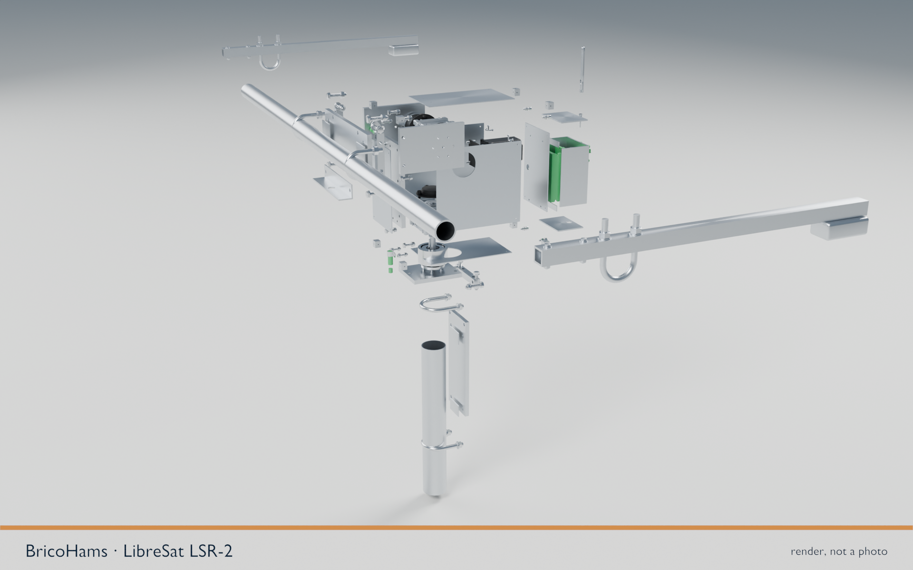
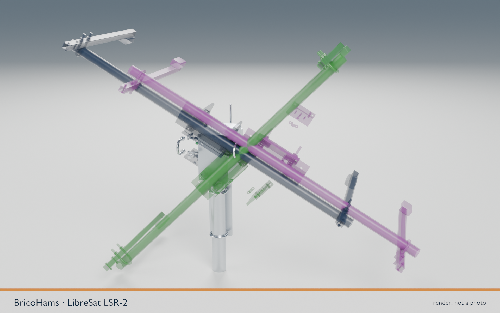
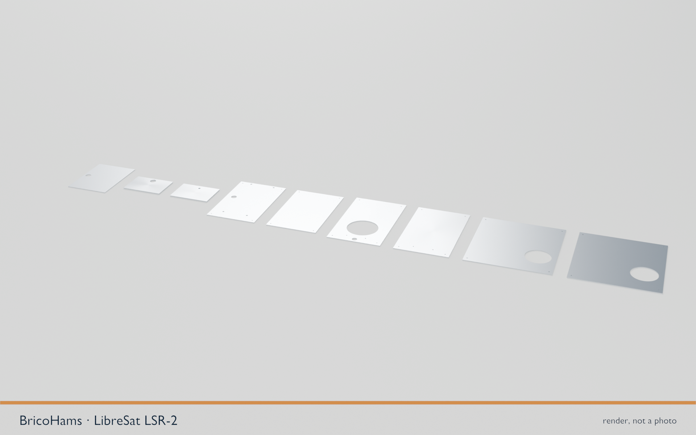
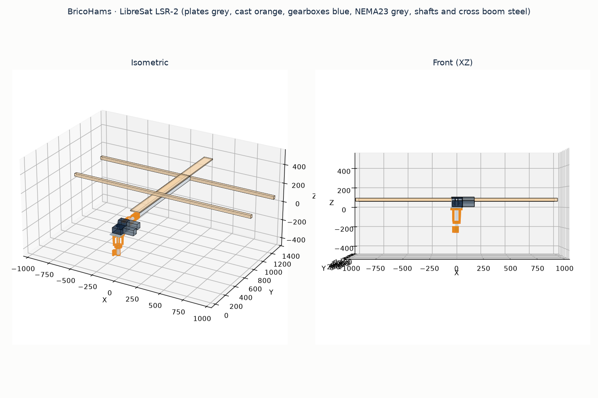
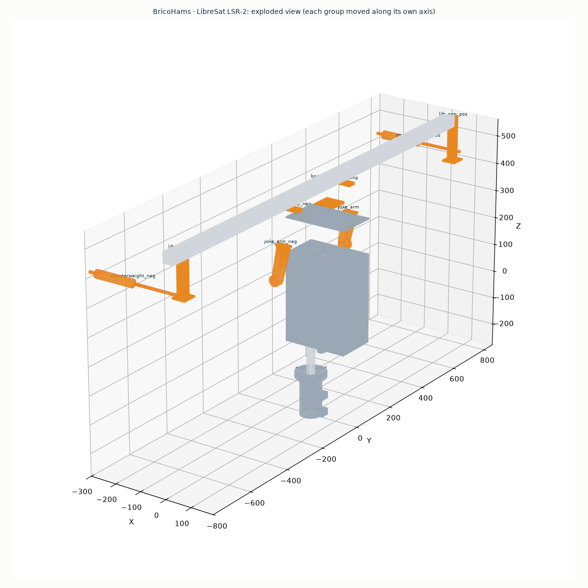
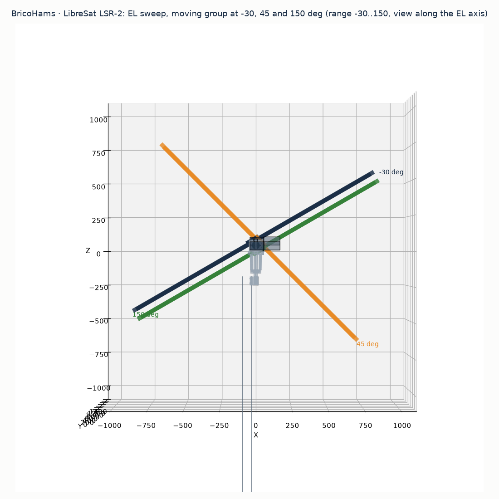
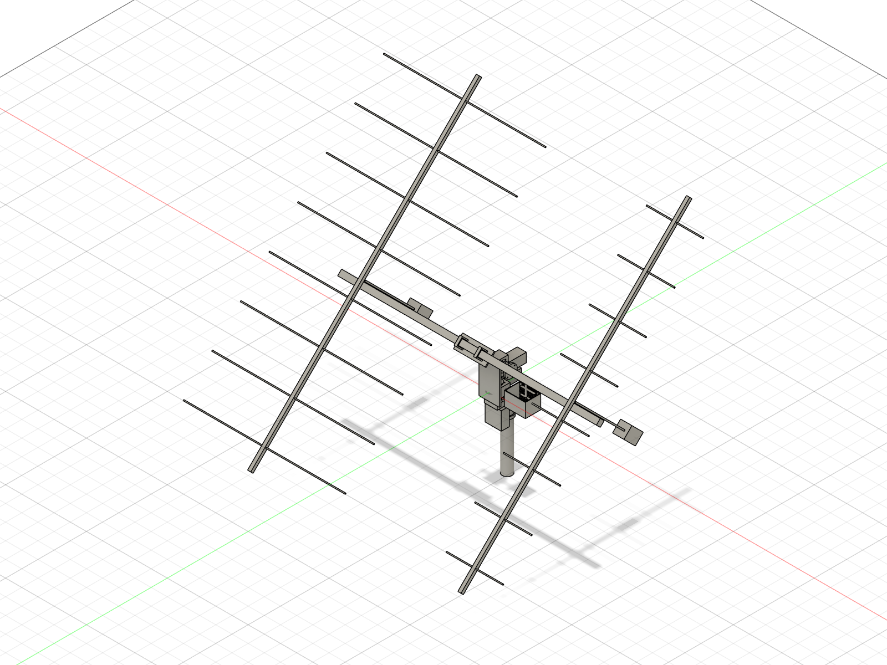
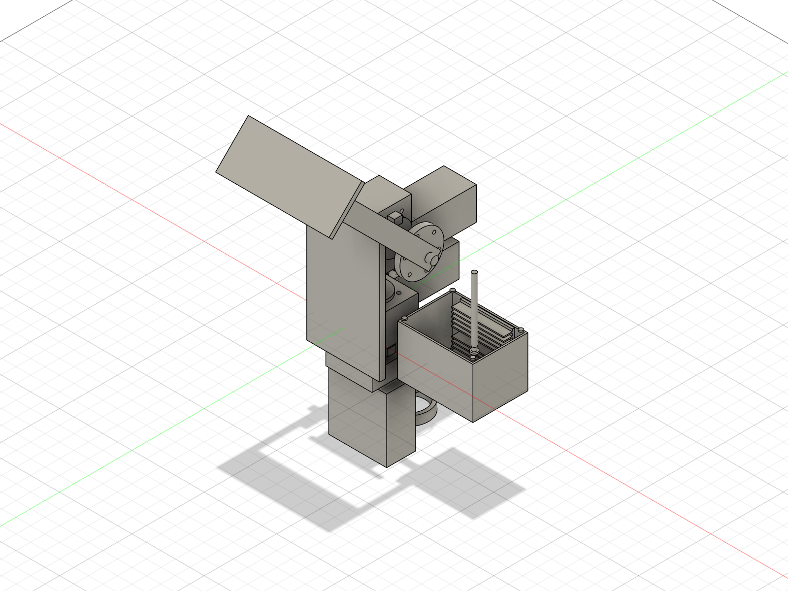

<p align="center"></p>

<p align="center"><a href="https://bricohams.org">bricohams.org</a> · Anatol EA5KAO · Diego EA5JEF · Pedro Roca Molina</p>

# BricoHams · LibreSat rotators (LSR-1 and LSR-2)

**Light, cheap, open az/el rotators for amateur satellites.** Authors: Anatol EA5KAO, Diego EA5JEF, Pedro Roca Molina.

| | LSR-1 (portable) | LSR-2 (fixed station, heavy) |
|---|---|---|
| Design | printed cycloid actuators, Pi head, tripod or backpack | **replica of the SARCNET SARCTrac Mk4** (MIT files in [`third_party/sarctrac-mk4`](third_party/sarctrac-mk4)) |
| Drive | 2 × printed cycloid 25:1 + NEMA17 | 2 × NMRV30 worm gearbox 50:1 + NEMA23 23HS32-4004S, DM542T drivers at 48 V |
| Mass / cost | ≈ 2.3 kg, ≈ 150 € ([BOM](docs/BOM.md)) | **≈ 15.9 kg, ≈ 900 € (est.)**, generated by `calc/lsr2_mk4_bom.py` ([BOM_LSR2](docs/BOM_LSR2.md)) |
| Range | AZ 0–450°, EL 0–180° (flip) | AZ ±360° (cable wrap), EL −30…150° |
| Speed / load | pass planner < 16°/s | 12°/s; wind, gravity and speed limits in [LSR2_SIZING](docs/LSR2_SIZING.md) |
| Accuracy target | < 0.1° after calibration ([CALIBRATION](docs/CALIBRATION.md)) | same target, acceptance in [LSR2_ACCEPTANCE](docs/LSR2_ACCEPTANCE.md) |

**Build pipeline:** `make calc` (engineering checks and generated docs) · `make lsr2` (LSR-2 CAD, STL, laser DXF, drawings, wiring, BOM, technical figures) · `make render` (photoreal renders with Blender) · `make test` (firmware host tests and software tests).

**Credits:** SARCNET (SARCTrac Mk4 FreeCAD files under the MIT licence, the base of LSR-2; Mk5 published data; ideas from MK1), [SatNOGS Rotator v3](https://gitlab.com/librespacefoundation/satnogs/satnogs-rotator), [AntRunner](https://github.com/wuxx/AntRunner), [Sweep Dynamics](https://www.sweepdynamics.com/). Licences are listed in [Licences](#licences). Branding: [docs/BRANDING.md](docs/BRANDING.md).

---

## LSR-1: portable rotator

**A light, cheap, open az/el rotator for working amateur satellites in the field.**

LSR-1 starts from two open designs, the [SatNOGS Rotator v3](https://gitlab.com/librespacefoundation/satnogs/satnogs-rotator) and [AntRunner](https://github.com/wuxx/AntRunner). It uses the compact printed cycloidal actuators popularised by [Sweep Dynamics](https://www.sweepdynamics.com/) and puts a Raspberry Pi at the head. The goal is a rotator a radio amateur can print, solder and carry in a backpack. It sits on any photo or survey tripod and tracks a light antenna of the BigSignal **SpaceQuad** or Arrow class. It controls the radio's Doppler on a **Yaesu FTX-1** and keeps an **OpenGD77** radio in sync.


| | LSR-1 | AntRunner | SatNOGS Rotator v3 |
|---|---|---|---|
| Weight (rotator + controller) | **≈ 2.3 kg** (estimate, [BOM](docs/BOM.md)) | 3 kg | ≈ 5 kg |
| Parts cost | **≈ 150 €** with a Pi Zero 2 W | n/a (sold assembled) | 300–400 USD |
| Drive | 2 × printed cycloid 25:1 + NEMA17, steel pins, thin-section bearings | GRBL steppers, acrylic frame | worm gear 30:1 + GT2 belt, 20×20 extrusion |
| Range | AZ 0–450° (cable wrap), EL 0–180° (**flip**) | AZ 0–360°, EL 0–180° | AZ 0–360°, EL 0–90° |
| Position sensing | absolute EL (accelerometer), AZ index + saved position, **closed loop** with magnetic encoders | none (manual north, open loop) | encoders + endstops |
| Head computer | Pi Zero 2 W on the board: Wi-Fi AP, web UI, rotctld, **onboard tracking** | ESP32 GRBL + external PC/phone | external PC |
| Radio | **FTX-1 CAT Doppler** (direct or Hamlib), any Hamlib rig, **OpenGD77** clock/keps | via Gpredict | via Gpredict |
| Field power | 9–24 V: LiFePO4 / USB-C PD power bank; ≈ 4 W average | 12 V | 12 V |
| Mount | 3/8″ & 1/4″ photo, 5/8″ survey, 35 mm stand, 25–40 mm mast | U-bolt | custom |

## LSR-2: fixed-station rotator (SARCTrac Mk4 replica)


*LSR-2 on its mast, antennas at EL 30°. Render, not a photo (`make render`).*

LSR-2 is the heavy az/el rotator for a fixed station. It is a replica of the **SARCNET SARCTrac Mk4** and is built from the SARCNET FreeCAD files, which are under the MIT licence. The copy, its licence and its provenance are in [`third_party/sarctrac-mk4`](third_party/sarctrac-mk4). The details are in [LSR2_MK4](docs/LSR2_MK4.md).

**Hardware**

| Group | Parts |
|---|---|
| Drive | 2 × NMRV30 worm gearbox 50:1 (AZ and EL), 2 × NEMA23 23HS32-4004S (2.4 N·m, 4.0 A) |
| Electronics | 2 × DM542T drivers on 48 V (S-400-48 supply); 2 × XL7015 converters for 12 V and 5 V; controller (Wemos D1 Mini Pro in the original Mk4, see Control below); NJK-5002C Hall index sensors; mechanical end stops. Everything sits in a Deltron 483-0100 diecast housing. |
| Structure | 10 mm aluminium plate, saddle plates, brackets and platform; 16 mm corner blocks; 2 mm laser-cut aluminium cover and enclosure; 25 mm SHS lift arms |
| Bearings and mounting | stainless azimuth hub, thrust-bearing washer stack, U-bolts to the mast |

**Mass and cost.** The totals are ≈ 15.9 kg and ≈ 900 € (est., EU hobby suppliers 2026).

- The mass covers the rotator head, the electronics housing, the lift arms, the saddle and the fasteners. It leaves out the mast, the antennas, the cables and the indoor PSU. The cost does include the PSU and the motor cable.
- Made-part masses come from the CAD build report and bought-part masses from catalogue values. Laser and CNC prices are estimates until real quotes are in.
- Groups, processes and buy-in stock are in [BOM_LSR2](docs/BOM_LSR2.md) and [LSR2_MATERIALS](docs/LSR2_MATERIALS.md).

**Build files.**

- `make lsr2` (`LSR2_DESIGN=mk4`, the default) produces one STL and one STEP per part, plus the editable `cad/lsr2/LSR2_assembly.FCStd` and `cad/lsr2/LSR2_assembly.step.zip`. The STEP is zipped to stay under GitHub's 100 MB file limit.
- The laser-cut DXF files go to [`cnc/lsr2/laser/`](cnc/lsr2/laser).
- The fabrication drawings are the original SARCNET PDFs, listed in [docs/drawings](docs/drawings/).

**Control.** Our firmware, protocol and head software are shared with LSR-1 and run on the LSR-CTL RP2040 board, using the EXT_STEPDIR driver and the `lsr2` profile ([FIRMWARE](docs/FIRMWARE.md)). The original Mk4 uses a Wemos D1 Mini Pro with its own firmware. Whether we keep the RP2040 board or port our firmware to the Wemos is still open (O35 in [LSR2_MK4](docs/LSR2_MK4.md)). Both speak EasyComm II, so PstRotator, Gpredict, SatPC32 and Orbitron work, as does our rotctld server. Wiring: [LSR2_wiring.svg](docs/drawings/LSR2_wiring.svg).

### LSR-2 renders


*Head with the cover removed: the 10 mm plate carries both worm gearboxes and motors. The saddle and the lift arms take the antenna boom.*



*Exploded view: head, cover panels, saddle, lift arms and the mast clamp.*



*Elevation range: the saddle and lift arms at −30°, 45° and 150° about the EL axis.*



*The 2 mm laser-cut cover and enclosure panels (DXF in `cnc/lsr2/laser/`).*

**Technical views** (matplotlib drawings from the same STL files, colour = material or part type):







### Optional cast/CNC variant and earlier studies

The phase-11 design stays available as an optional variant (`LSR2_DESIGN=cast`). It is an open aluminium box with our own geometry from `cad/lsr2/*.py`, either sand-cast in A356 ([route A](docs/LSR2_ROUTE_A_CASTING.md)) or machined from slabs ([route B](docs/LSR2_ROUTE_B_CNC.md)). It uses 80:1 gearboxes and can take our own LSR-WG30 gearbox. Its drawings are in [docs/drawings/cast_variant](docs/drawings/cast_variant/). The Fusion layout is a study of the Mk5-style arrangement with our own dimensions ([LSR2_FUSION](docs/LSR2_FUSION.md)).






## What is in the box

| Folder | Contents |
|---|---|
| [`cad/`](cad) | LSR-1: OpenSCAD source of every printed part (`lsr.scad`, parameters in `lsr_params.scad`). LSR-2: `cad/lsr2/` FreeCAD build scripts (`build.py`, `mk4_build.py`, `mk4_params.py`), the assembly model and the zipped STEP |
| [`third_party/sarctrac-mk4/`](third_party/sarctrac-mk4) | SARCNET SARCTrac Mk4 FreeCAD files and drawings (MIT), with LICENSE, PROVENANCE and checksums |
| [`stl/`](stl) | Ready-to-print LSR-1 STL; LSR-2 STL per part in `stl/lsr2/` |
| [`cnc/`](cnc) | LSR-2 laser-cut DXF (`cnc/lsr2/laser/`) |
| [`hardware/`](hardware) | **LSR-CTL** controller board: KiCad 7 PCB generated by script, autorouted, DRC-clean, plus **Gerbers**, drill, BOM, pick-and-place and netlist in `hardware/fab/` |
| [`firmware/`](firmware) | RP2040 (Raspberry Pi Pico) firmware in C/C++ (Pico SDK): Easycomm II, closed loop, TMC2209 UART, IMU, GPS, LSR-2 EXT_STEPDIR profile, plus host unit tests |
| [`software/`](software) | Python head software for the Pi (`lsr`): tracker with pass planner, rotctld server, web UI, Doppler CAT (FTX-1, Hamlib), OpenGD77 tools, simulator and tests |
| [`calc/`](calc) | Engineering checks: LSR-1 cycloid, torque, speed, energy; LSR-2 sizing, materials and BOM |
| [`scripts/`](scripts) | Generators: BOM, drawings, wiring diagram, technical figures and Blender renders |
| [`docs/`](docs) | Every process, step by step (list below) |
| [`bom/`](bom) | Bills of materials with prices and masses |

## Documentation

**LSR-1 and shared**

1. [Design analysis](docs/DESIGN_ANALYSIS.md): what we took from SatNOGS v3, AntRunner, Sweep Dynamics and SARCNET, and what we changed and why.
2. [Engineering budget](docs/SIZING.md): torque, speed, pass dynamics and energy (generated by `calc/sizing.py`).
3. [Bill of materials](docs/BOM.md).
4. [Mechanical build](docs/MECHANICAL.md): printing, actuator assembly, base, head, antenna and tripod.
5. [Electronics](docs/ELECTRONICS.md): LSR-CTL board, pin map, soldering, harness, sensors and bring-up; LSR-2 drivers and power.
6. [Firmware](docs/FIRMWARE.md): build and flash, the command protocol, settings, referencing and the `lsr2` profile.
7. [Head software](docs/SOFTWARE.md): Pi install, web UI, Gpredict/Look4Sat/SatNOGS, FTX-1, Hamlib and OpenGD77.
8. [Power](docs/POWER.md): batteries, USB-C PD, protection and the energy budget.
9. [Calibration and field use](docs/FIELD_GUIDE.md): from the bag to the first QSO in 10 minutes. [Automatic calibration and pointing correction](docs/CALIBRATION.md): level, GPS, compass, Sun, index/backlash, pointing fit.
10. [Testing](docs/TESTING.md): unit, bench and acceptance tests with result sheets.
11. [Family architecture](docs/ARCHITECTURE.md): LSR-1 and LSR-2, the shared stack, phase status.

**LSR-2**

12. [SARCTrac Mk4 replica](docs/LSR2_MK4.md): credit and licence, parts by process, build, laser DXF, electronics, differences, open items.
13. [Engineering budget](docs/LSR2_SIZING.md): wind and gravity torques, bearings, mast, clamps, fixings, power, pointing error. Inputs in [LSR2_INPUTS](docs/LSR2_INPUTS.md).
14. [Materials and cost](docs/LSR2_MATERIALS.md): stock per material, nesting, waste and cost.
15. [Bill of materials](docs/BOM_LSR2.md): every made and bought part, with mass and cost totals.
16. [Assembly guide](docs/LSR2_ASSEMBLY.md): order following the SARCNET assembly drawings, fasteners and torques, cabling and corrosion protection.
17. [Tolerances](docs/LSR2_TOLERANCES.md) and [inspection sheet](docs/LSR2_INSPECTION.md) (generated from `cad/lsr2/tolerances.py`).
18. [Drawings](docs/drawings/): SARCNET PDFs, exploded view with BOM balloons, and the [wiring diagram](docs/drawings/LSR2_wiring.svg).
19. [Risk review](docs/LSR2_RISKS.md), [test plan](docs/LSR2_TEST_PLAN.md) and [acceptance checklist](docs/LSR2_ACCEPTANCE.md).
20. [Open items](docs/OPEN_ITEMS.md): everything that needs the real world (measurements, quotes, tests).
21. Optional cast/CNC variant: [design spec](docs/superpowers/specs/2026-11-16-lsr2-heavy-rotator-design.md) (historical), [route A casting](docs/LSR2_ROUTE_A_CASTING.md), [route B CNC](docs/LSR2_ROUTE_B_CNC.md), [Fusion layout](docs/LSR2_FUSION.md).

## Key ideas (LSR-1)

- **One actuator, printed twice.** A NEMA17 drives a 25:1 two-disc cycloidal reducer that runs on 26 steel dowel ring pins. The output runs in two thin-section 61810 bearings. It is 94 mm across and about 45 mm long plus the motor. The tooth profile is checked in `calc/cycloid_check.py`, with 0.13 mm minimum running clearance over a full cycle.
- **No endstops needed.**
  - Elevation is absolute: an accelerometer on the elevation stub measures gravity.
  - Azimuth comes back from the position saved in flash, checked against the motor encoder, or from a hall index magnet (`HOME`).
  - True north is found by **pointing at the Sun** with the printed sun sight: one button press.
- **Closed loop.** An AS5600 on each motor's rear shaft detects lost steps and re-synchronises the step counter.
- **Automatic calibration and pointing model (Phase 8).** `lsr calibrate level|compass|sun|sun-manual|index|all` uses GPS time and position, the Sun and the IMUs; `lsr pointing fit` fits north, horizon, tilt, non-perpendicularity, collimation, eccentricity and backlash terms and reports the residual RMS (goal < 0.1°). Optional closed loop with step-loss and stall detection, soft limits and safe states. See [Calibration](docs/CALIBRATION.md); the ideas follow SARCNET MK1 and Rotator7.
- **Flip and cable-wrap planner.** Overhead passes need more than 50°/s of azimuth with a plain az/el rotator. The planner instead chooses between normal, over-the-top (elevation 0–180°) and wrap-shifted trajectories. In a one-week simulation of 156 passes, every pass stayed under 16°/s with less than 0.7° pointing error ([SIZING](docs/SIZING.md)).
- **The Pi is the rotator head.** It runs its own Wi-Fi hotspot, a mobile web UI, offline TLEs, and a GPS position and clock. Its `rotctld` on port 4533 accepts Gpredict, Look4Sat, SatNOGS or any Hamlib client.
- **Doppler done right.** FM satellites are corrected on both uplink and downlink. Linear transponders follow the RX knob: tune the downlink and the uplink follows, inverting or not. The FTX-1 runs MAIN as RX and SUB as TX, with no hardware split.

## Quick start

```bash
make            # STL + renders, PCB fab outputs, firmware .uf2, unit tests, engineering docs
make test       # firmware host tests + software tests only
cd software && pip install . && lsr run --sim    # web UI on http://localhost:8080 with a simulated rotator
```

Requirements: OpenSCAD, KiCad 7, Java 17 (Freerouting, only to re-route the PCB), the ARM GCC toolchain with Pico SDK 2.x, and Python 3.9+. LSR-2 also needs FreeCAD 1.x (`freecadcmd`) and, for renders, Blender 5.x. See each document for details.

## Status and safety

This is a complete, reviewed design. **Neither rotator has yet been built and measured as a whole.** The simulations, unit tests, DRC and kinematic checks pass. LSR-2 prices are estimates, and its target firmware build and bench tests are still open ([OPEN_ITEMS](docs/OPEN_ITEMS.md)). Before you order boards, check the items marked **VERIFY** in the documents:

- the TMC2209 module pinout;
- the AP63205 pinout;
- the FTX-1 `FB` command and CAT tone syntax;
- OpenGD77 keps upload, which is experimental and makes a backup first.

Satellites change status often. Check the [AMSAT status page](https://www.amsat.org/status/) before a pass.

## Licences

- Hardware (CAD, PCB): **CERN-OHL-S-2.0**.
- `third_party/sarctrac-mk4`: **MIT** (SARCNET; SARCTrac Mk4 FreeCAD files, see its LICENSE and PROVENANCE.md).
- Firmware and software: **GPL-3.0-or-later**.
- Documentation and images: **CC BY-SA 4.0**.

See [LICENSE](LICENSE). Hamlib, Gpredict, OpenGD77, SatNOGS and AntRunner are the work of their respective authors, and LSR-1 only talks to them through their public interfaces.
