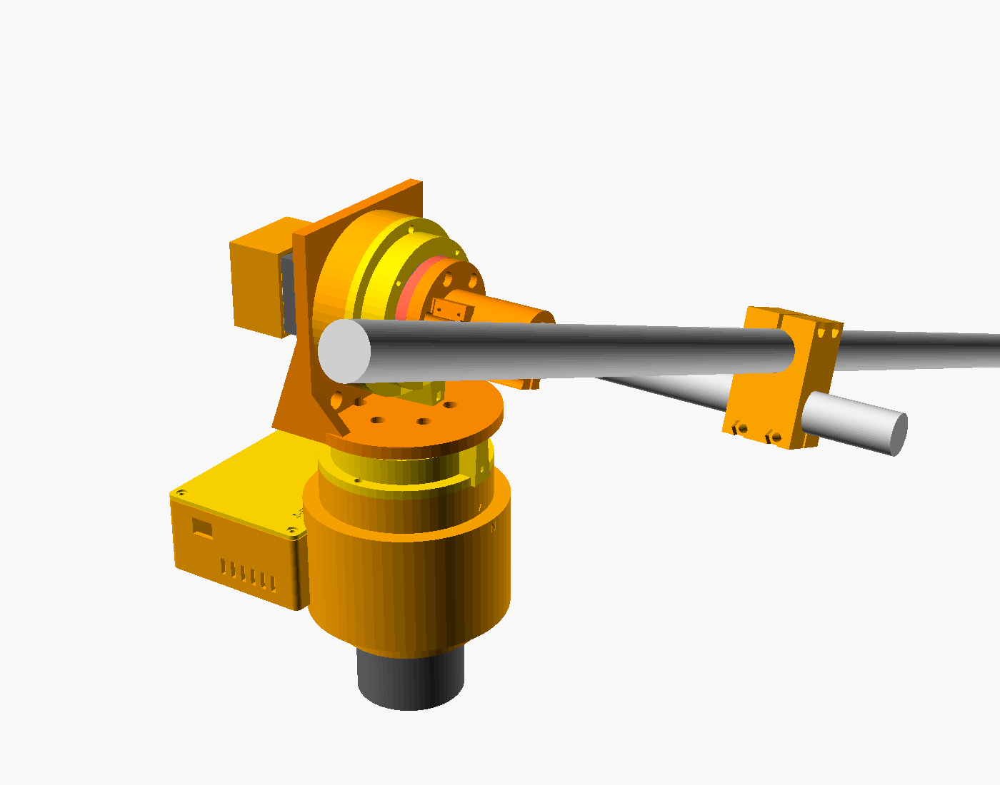

# LibreSat Rotator LSR-1

**A light, cheap, open az/el rotator for working amateur satellites in the field.**

LSR-1 starts from two open designs, the [SatNOGS Rotator v3](https://gitlab.com/librespacefoundation/satnogs/satnogs-rotator) and [AntRunner](https://github.com/wuxx/AntRunner). It uses the compact printed cycloidal actuators popularised by [Sweep Dynamics](https://www.sweepdynamics.com/) and puts a Raspberry Pi at the head. The goal is a rotator a radio amateur can print, solder and carry in a backpack. It sits on any photo or survey tripod and tracks a light antenna of the BigSignal **SpaceQuad** or Arrow class. It controls the radio's Doppler on a **Yaesu FTX-1** and keeps an **OpenGD77** radio in sync.



## LSR family / LSR-2 heavy station

LSR-1 is the portable rotator. **LSR-2** is a fixed-station heavy az/el rotator (NMRV030 worm gearbox + NEMA23, CNC aluminium plates and sand-cast A356 parts), driven by the same firmware, protocol and head software. Mechanical phases 1-3 are done: parameters and sizing, CNC plates, and the cast parts (AZ bearing housing, mast clamp, EL hubs) with their PLA patterns, a core box and the turned stainless shafts. The AZ shaft is **hollow** (Ø16 bore) so the rotator cables run up the AZ axis, with no cable wrap round the mast. Firmware and software (phases 4-5) are still pending. See the [family architecture](docs/ARCHITECTURE.md), the [design spec](docs/superpowers/specs/2026-11-16-lsr2-heavy-rotator-design.md), the [LSR-2 sizing and structural checks](docs/LSR2_SIZING.md) and the [LSR-2 materials and cost](docs/LSR2_MATERIALS.md).


| | LSR-1 | AntRunner | SatNOGS Rotator v3 |
|---|---|---|---|
| Weight (rotator + controller) | **≈ 2.3 kg** (estimate, [BOM](docs/BOM.md)) | 3 kg | ≈ 5 kg |
| Parts cost | **≈ 150 €** with a Pi Zero 2 W | n/a (sold assembled) | 300–400 USD |
| Drive | 2 × printed cycloid 25:1 + NEMA17, steel pins, thin-section bearings | GRBL steppers, acrylic frame | worm gear 30:1 + GT2 belt, 20×20 extrusion |
| Range | AZ 0–450° (cable wrap), EL 0–180° (**flip**) | AZ 0–360°, EL 0–180° | AZ 0–360°, EL 0–90° |
| Position sensing | absolute EL (accelerometer), AZ index + saved position, **closed loop** with magnetic encoders | none (manual north, open loop) | encoders + endstops |
| Head computer | Pi Zero 2 W on the board: Wi-Fi AP, web UI, rotctld, **onboard tracking** | ESP32 GRBL + external PC/phone | external PC |
| Radio | **FTX-1 CAT Doppler** (direct or Hamlib), any Hamlib rig, **OpenGD77** clock/keps | via Gpredict | via Gpredict |
| Field power | 9–24 V: LiFePO4 / USB-C PD power bank; ≈ 4 W average | 12 V | 12 V |
| Mount | 3/8″ & 1/4″ photo, 5/8″ survey, 35 mm stand, 25–40 mm mast | U-bolt | custom |

## What is in the box

| Folder | Contents |
|---|---|
| [`cad/`](cad) | OpenSCAD source of every printed part (`lsr.scad`, parameters in `lsr_params.scad`) |
| [`stl/`](stl) | Ready-to-print STL: actuator, structure, tripod adapters, antenna clamps, e-box |
| [`hardware/`](hardware) | **LSR-CTL** controller board: KiCad 7 PCB generated by script, autorouted, DRC-clean, plus **Gerbers**, drill, BOM, pick-and-place and netlist in `hardware/fab/` |
| [`firmware/`](firmware) | RP2040 (Raspberry Pi Pico) firmware in C/C++ (Pico SDK): Easycomm II, closed loop, TMC2209 UART, IMU, GPS, plus host unit tests |
| [`software/`](software) | Python head software for the Pi (`lsr`): tracker with pass planner, rotctld server, web UI, Doppler CAT (FTX-1, Hamlib), OpenGD77 tools, simulator, 25 tests |
| [`calc/`](calc) | Engineering checks: cycloid meshing, torque and speed, pass dynamics, energy |
| [`docs/`](docs) | Every process, step by step (list below) |
| [`bom/`](bom) | Bill of materials with prices and masses |

## Documentation

1. [Design analysis](docs/DESIGN_ANALYSIS.md): what we took from SatNOGS v3, AntRunner and Sweep Dynamics, and what we changed and why.
2. [Engineering budget](docs/SIZING.md): torque, speed, pass dynamics and energy (generated by `calc/sizing.py`).
3. [Bill of materials](docs/BOM.md).
4. [Mechanical build](docs/MECHANICAL.md): printing, actuator assembly, base, head, antenna and tripod.
5. [Electronics](docs/ELECTRONICS.md): LSR-CTL board, pin map, soldering, harness, sensors and bring-up.
6. [Firmware](docs/FIRMWARE.md): build and flash, the command protocol, settings and referencing.
7. [Head software](docs/SOFTWARE.md): Pi install, web UI, Gpredict/Look4Sat/SatNOGS, FTX-1, Hamlib and OpenGD77.
8. [Power](docs/POWER.md): batteries, USB-C PD, protection and the energy budget.
9. [Calibration and field use](docs/FIELD_GUIDE.md): from the bag to the first QSO in 10 minutes.
10. [Testing](docs/TESTING.md): unit, bench and acceptance tests with result sheets.
11. [Family architecture](docs/ARCHITECTURE.md): LSR-1 and LSR-2, shared stack, LSR-2 mechanics and fabrication route.
12. [LSR-2 design spec](docs/superpowers/specs/2026-11-16-lsr2-heavy-rotator-design.md): goals, licence position, changes against the SARCTrac Mk5, phases.
13. [LSR-2 engineering budget](docs/LSR2_SIZING.md): torque, overturning moment, gearbox choice per payload and structural checks of the cast parts.
14. [LSR-2 materials and cost](docs/LSR2_MATERIALS.md): plate, casting and shaft mass, stock, waste and cost.

## Key ideas

- **One actuator, printed twice.** A NEMA17 drives a 25:1 two-disc cycloidal reducer that runs on 26 steel dowel ring pins. The output runs in two thin-section 61810 bearings. It is 94 mm across and about 45 mm long plus the motor. The tooth profile is checked in `calc/cycloid_check.py`, with 0.13 mm minimum running clearance over a full cycle.
- **No endstops needed.**
  - Elevation is absolute: an accelerometer on the elevation stub measures gravity.
  - Azimuth comes back from the position saved in flash, checked against the motor encoder, or from a hall index magnet (`HOME`).
  - True north is found by **pointing at the Sun** with the printed sun sight: one button press.
- **Closed loop.** An AS5600 on each motor's rear shaft detects lost steps and re-synchronises the step counter.
- **Flip and cable-wrap planner.** Overhead passes need more than 50°/s of azimuth with a plain az/el rotator. The planner instead chooses between normal, over-the-top (elevation 0–180°) and wrap-shifted trajectories. In a one-week simulation of 156 passes, every pass stayed under 16°/s with less than 0.7° pointing error ([SIZING](docs/SIZING.md)).
- **The Pi is the rotator head.** It runs its own Wi-Fi hotspot, a mobile web UI, offline TLEs, and a GPS position and clock. Its `rotctld` on port 4533 accepts Gpredict, Look4Sat, SatNOGS or any Hamlib client.
- **Doppler done right.** FM satellites are corrected on both uplink and downlink. Linear transponders follow the RX knob: tune the downlink and the uplink follows, inverting or not. The FTX-1 runs MAIN as RX and SUB as TX, with no hardware split.

## Quick start

```bash
make            # STL + renders, PCB fab outputs, firmware .uf2, unit tests, engineering docs
make test       # firmware host tests + software tests only
cd software && pip install . && lsr run --sim    # web UI on http://localhost:8080 with a simulated rotator
```

Requirements: OpenSCAD, KiCad 7, Java 17 (Freerouting, only to re-route the PCB), the ARM GCC toolchain with Pico SDK 2.x, and Python 3.9+. See each document for details.

## Status and safety

This is a complete, reviewed design. **Version 1.0 has not yet been built and measured as a whole.** The simulations, unit tests, DRC and kinematic checks pass. Before you order boards, check the items marked **VERIFY** in the documents:

- the TMC2209 module pinout;
- the AP63205 pinout;
- the FTX-1 `FB` command and CAT tone syntax;
- OpenGD77 keps upload, which is experimental and makes a backup first.

Satellites change status often. Check the [AMSAT status page](https://www.amsat.org/status/) before a pass.

## Licences

- Hardware (CAD, PCB): **CERN-OHL-S-2.0**.
- Firmware and software: **GPL-3.0-or-later**.
- Documentation and images: **CC BY-SA 4.0**.

See [LICENSE](LICENSE). Hamlib, Gpredict, OpenGD77, SatNOGS and AntRunner are the work of their respective authors, and LSR-1 only talks to them through their public interfaces.
