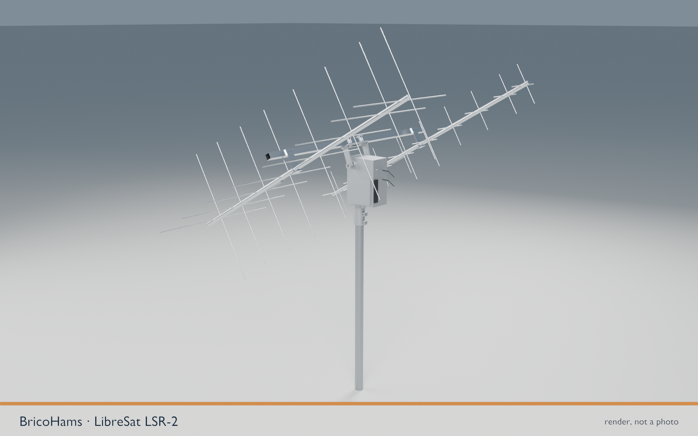
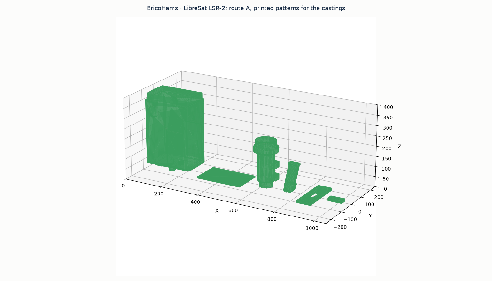
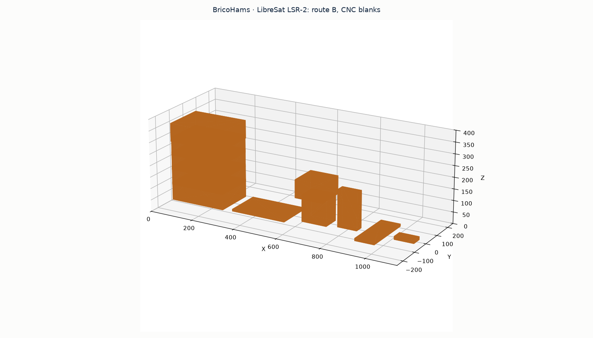
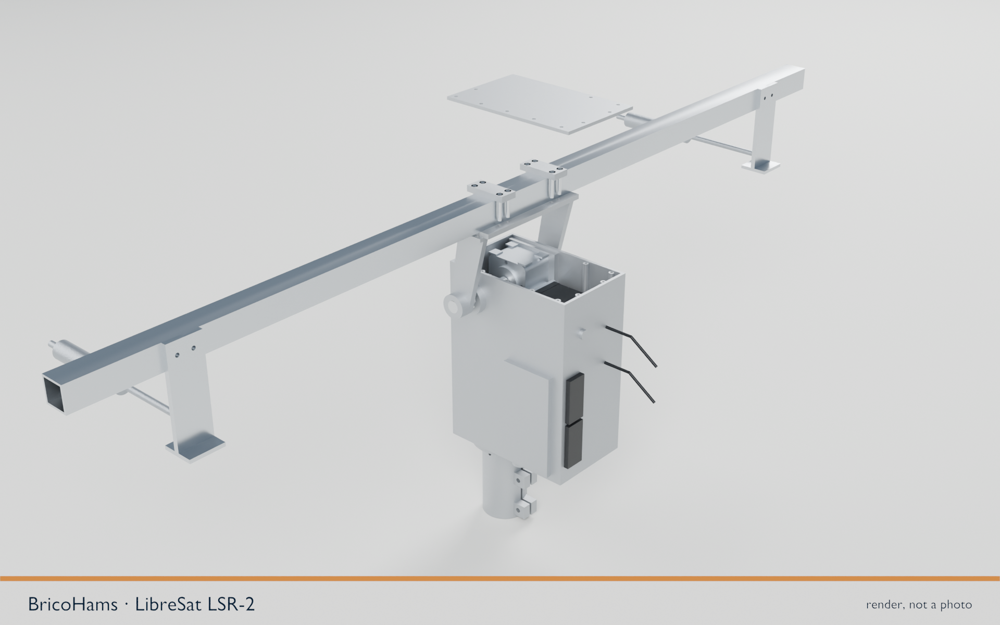
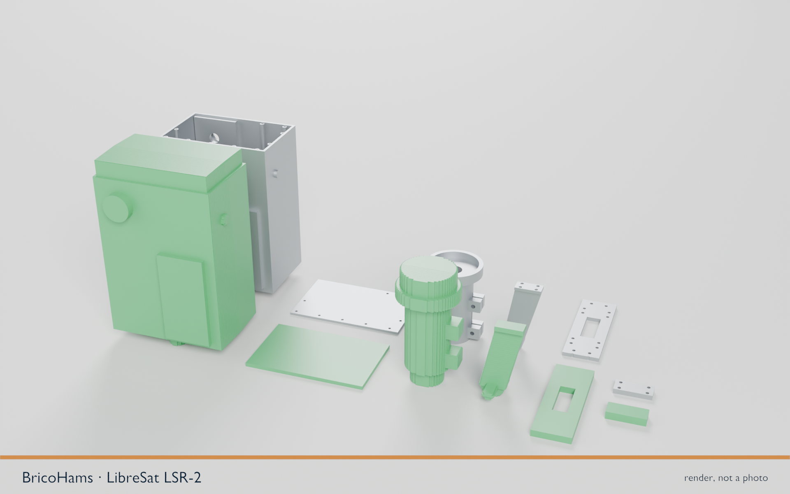
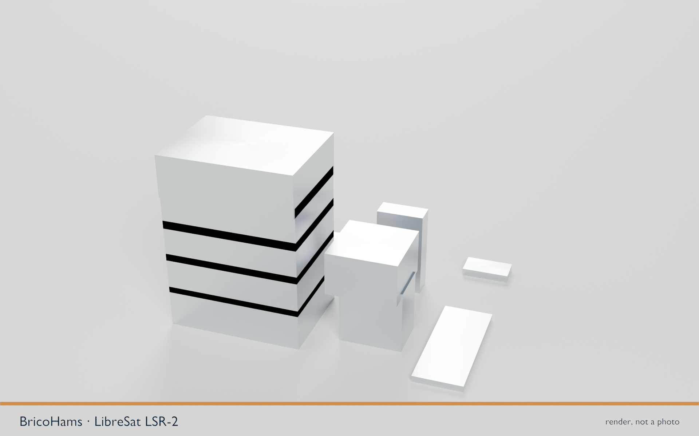

<p align="center"></p>

<p align="center"><a href="https://bricohams.org">bricohams.org</a> · Anatol EA5KAO · Diego EA5JEF · Pedro Roca Molina</p>

# BricoHams · LibreSat rotators (LSR-1 and LSR-2)

**Light, cheap, open az/el rotators for amateur satellites.** Authors: Anatol EA5KAO, Diego EA5JEF, Pedro Roca Molina.

| | LSR-1 (portable) | LSR-2 (fixed station, heavy) |
|---|---|---|
| What | printed cycloid actuators, Pi head, tripod/backpack | Mk5-schematic aluminium open-box body, 2 × NMRV030 80:1 + NEMA23, mast mount |
| Mass / cost | ≈ 2.3 kg, ≈ 150 € ([BOM](docs/BOM.md)) | mass and cost in [BOM_LSR2](docs/BOM_LSR2.md) and [LSR2_MATERIALS](docs/LSR2_MATERIALS.md) (generated) |
| Range | AZ 0–450°, EL 0–180° (flip) | AZ ±360° (cable wrap), EL −30…150° |
| Speed / load | pass planner < 16°/s | wind, gravity and speed limits in [LSR2_SIZING](docs/LSR2_SIZING.md) |
| Accuracy target | < 0.1° after calibration ([CALIBRATION](docs/CALIBRATION.md)) | same target, acceptance in [LSR2_ACCEPTANCE](docs/LSR2_ACCEPTANCE.md) |



**Build pipeline:** `make calc` (engineering checks and generated docs) · `make lsr2` (LSR-2 CAD, STL, drawings, wiring, BOM, technical figures) · `make render` (photoreal renders, Blender) · `make test` (firmware host tests + software tests).

**Phases:** 1–2 calc and CAD framework, 3 materials, 4 firmware EXT_STEPDIR and `lsr2` profile, 5 BOM, assembly, branding, 6/6b/6c two-block layout (superseded) and Mk5 alignment, 7 optional own worm gearbox, 8 calibration and pointing model, 9 materials/BOM/render pipeline, 10 completeness audit, 11 Mk5-schematic architecture: all done on paper and in simulation. The first casting, quotes, bench tests and target firmware compile stay open in [OPEN_ITEMS](docs/OPEN_ITEMS.md) (status per phase in [ARCHITECTURE §7](docs/ARCHITECTURE.md)).

**Doc map:** every document is listed in [Documentation](#documentation) below.

**Credits:** SARCNET (SARCTrac Mk5 published data and MK1-derived ideas; no SARCNET geometry is used), [SatNOGS Rotator v3](https://gitlab.com/librespacefoundation/satnogs/satnogs-rotator), [AntRunner](https://github.com/wuxx/AntRunner), [Sweep Dynamics](https://www.sweepdynamics.com/). Licences: hardware CERN-OHL-S-2.0, software GPL-3.0-or-later, docs CC BY-SA 4.0 (see [Licences](#licences)). Branding: [docs/BRANDING.md](docs/BRANDING.md).

---

## LibreSat Rotator LSR-1

**A light, cheap, open az/el rotator for working amateur satellites in the field.**

LSR-1 starts from two open designs, the [SatNOGS Rotator v3](https://gitlab.com/librespacefoundation/satnogs/satnogs-rotator) and [AntRunner](https://github.com/wuxx/AntRunner). It uses the compact printed cycloidal actuators popularised by [Sweep Dynamics](https://www.sweepdynamics.com/) and puts a Raspberry Pi at the head. The goal is a rotator a radio amateur can print, solder and carry in a backpack. It sits on any photo or survey tripod and tracks a light antenna of the BigSignal **SpaceQuad** or Arrow class. It controls the radio's Doppler on a **Yaesu FTX-1** and keeps an **OpenGD77** radio in sync.


## LSR family / LSR-2 heavy station


*LSR-2 on its mast, antennas at EL 30°: render, not a photo (`make render`).*

LSR-1 is the portable rotator. **LSR-2** is a fixed-station heavy az/el rotator (phase 11, the Mk5-schematic architecture of the [owner's brief](docs/reference/BRICOHAMS_LSR2_BRIEF.md)): one open-box aluminium body with ribs and a gasketed removable lid (origin at its bottom mounting face, AZ vertical, EL horizontal), the AZ NMRV030 gearbox low and the EL gearbox high with both NEMA23 motors on the same side, the DM542 drivers on an inner wall with a thermal path, and an EL through-shaft that drives a U-yoke, a saddle plate and a 40 × 40 × 3 cross boom parallel to the EL axis, with lift arms, antennas and counterweights at the boom ends and a mast clamp bracket below. Dedicated bearings (2 × 6206 + 51206 on AZ, 2 × 6004 on EL) take the external loads, so the gearboxes only transmit torque. Parts are sand-cast A356 (route A) or CNC aluminium slabs (route B); our own geometry comes from `cad/lsr2/*.py`. Phase 11e delivers the editable assembly, dimensioned drawings, tolerances, inspection sheet, risk review, assembly guide and test plan (see the documentation list). Phase 7 adds an own two-half cast worm gearbox LSR-WG30 as an optional drop-in for the NMRV030 (`LSR2_GEARBOX=lsr_wg30`; capacity, cost and open decisions in [ARCHITECTURE §7f](docs/ARCHITECTURE.md): the bought unit stays the default). Firmware, protocol and head software are shared with LSR-1 (EXT_STEPDIR driver and `lsr2` profile, [docs/FIRMWARE.md](docs/FIRMWARE.md)); the Mk5 adopted and rejected items are in the [family architecture](docs/ARCHITECTURE.md). Compatible trackers: PstRotator, Gpredict, SatPC32 and Orbitron (EasyComm II), plus our rotctld path. See the [design spec](docs/superpowers/specs/2026-11-16-lsr2-heavy-rotator-design.md), the [sizing and structural checks](docs/LSR2_SIZING.md), the [materials and cost](docs/LSR2_MATERIALS.md) and the [BOM](docs/BOM_LSR2.md).

**Fusion layout model** (fully constrained Mk5-style arrangement, own dimensions, [LSR2_FUSION](docs/LSR2_FUSION.md)):


**Technical views** (matplotlib line drawings from the same STL files):













| | LSR-1 | AntRunner | SatNOGS Rotator v3 |
|---|---|---|---|
| Weight (rotator + controller) | **≈ 2.3 kg** (estimate, [BOM](docs/BOM.md)) | 3 kg | ≈ 5 kg |
| Parts cost | **≈ 150 €** with a Pi Zero 2 W | n/a (sold assembled) | 300–400 USD |
| Drive | 2 × printed cycloid 25:1 + NEMA17, steel pins, thin-section bearings | GRBL steppers, acrylic frame | worm gear 30:1 + GT2 belt, 20×20 extrusion |
| Range | AZ 0–450° (cable wrap), EL 0–180° (**flip**) | AZ 0–360°, EL 0–180° | AZ 0–360°, EL 0–90° |
| Position sensing | absolute EL (accelerometer), AZ index + saved position, **closed loop** with magnetic encoders | none (manual north, open loop) | encoders + endstops |
| Head computer | Pi Zero 2 W on the board: Wi-Fi AP, web UI, rotctld, **onboard tracking** | ESP32 GRBL + external PC/phone | external PC |
| Radio | **FTX-1 CAT Doppler** (direct or Hamlib), any Hamlib rig, **OpenGD77** clock/keps | via Gpredict | via Gpredict |
| Field power | 9–24 V: LiFePO4 / USB-C PD power bank; ≈ 4 W average | 12 V | 12 V |
| Mount | 3/8″ & 1/4″ photo, 5/8″ survey, 35 mm stand, 25–40 mm mast | U-bolt | custom |

## What is in the box

| Folder | Contents |
|---|---|
| [`cad/`](cad) | OpenSCAD source of every printed part (`lsr.scad`, parameters in `lsr_params.scad`) |
| [`stl/`](stl) | Ready-to-print STL: actuator, structure, tripod adapters, antenna clamps, e-box |
| [`hardware/`](hardware) | **LSR-CTL** controller board: KiCad 7 PCB generated by script, autorouted, DRC-clean, plus **Gerbers**, drill, BOM, pick-and-place and netlist in `hardware/fab/` |
| [`firmware/`](firmware) | RP2040 (Raspberry Pi Pico) firmware in C/C++ (Pico SDK): Easycomm II, closed loop, TMC2209 UART, IMU, GPS, plus host unit tests |
| [`software/`](software) | Python head software for the Pi (`lsr`): tracker with pass planner, rotctld server, web UI, Doppler CAT (FTX-1, Hamlib), OpenGD77 tools, simulator, 25 tests |
| [`calc/`](calc) | Engineering checks: cycloid meshing, torque and speed, pass dynamics, energy |
| [`docs/`](docs) | Every process, step by step (list below) |
| [`bom/`](bom) | Bill of materials with prices and masses |

## Documentation

1. [Design analysis](docs/DESIGN_ANALYSIS.md): what we took from SatNOGS v3, AntRunner and Sweep Dynamics, and what we changed and why.
2. [Engineering budget](docs/SIZING.md): torque, speed, pass dynamics and energy (generated by `calc/sizing.py`).
3. [Bill of materials](docs/BOM.md).
4. [Mechanical build](docs/MECHANICAL.md): printing, actuator assembly, base, head, antenna and tripod.
5. [Electronics](docs/ELECTRONICS.md): LSR-CTL board, pin map, soldering, harness, sensors and bring-up.
6. [Firmware](docs/FIRMWARE.md): build and flash, the command protocol, settings and referencing.
7. [Head software](docs/SOFTWARE.md): Pi install, web UI, Gpredict/Look4Sat/SatNOGS, FTX-1, Hamlib and OpenGD77.
8. [Power](docs/POWER.md): batteries, USB-C PD, protection and the energy budget.
9. [Calibration and field use](docs/FIELD_GUIDE.md): from the bag to the first QSO in 10 minutes. [Automatic calibration and pointing correction](docs/CALIBRATION.md): level, GPS, compass, Sun, index/backlash, pointing fit.
10. [Testing](docs/TESTING.md): unit, bench and acceptance tests with result sheets.
11. [Family architecture](docs/ARCHITECTURE.md): LSR-1 and LSR-2, shared stack, LSR-2 mechanics and fabrication route.
12. [LSR-2 design spec](docs/superpowers/specs/2026-11-16-lsr2-heavy-rotator-design.md): goals, licence position, changes against the SARCTrac Mk5, phases.
13. [LSR-2 engineering budget](docs/LSR2_SIZING.md) (Mk5-schematic architecture, phase 11a): wind and gravity torques, bearings, mast, clamps, fixings, pointing error; input data and open decisions in [LSR-2 inputs](docs/LSR2_INPUTS.md).
14. [LSR-2 materials and cost](docs/LSR2_MATERIALS.md): plate, casting and shaft mass, stock, waste and cost.
15. [LSR-2 bill of materials](docs/BOM_LSR2.md): every fabricated and bought part, fasteners, electronics, totals of mass and cost.
16. [LSR-2 assembly guide](docs/LSR2_ASSEMBLY.md): installation order, fasteners and torques, bearing/seal fitting, gearbox coupling, balancing, cabling and corrosion protection.
17. [LSR-2 tolerances](docs/LSR2_TOLERANCES.md) (generated from `cad/lsr2/tolerances.py`): datums, ISO fits, finishes, casting versus CNC capability.
18. [LSR-2 inspection sheet](docs/LSR2_INSPECTION.md): feature, nominal, tolerance, gauge, empty result column.
19. [LSR-2 risk review](docs/LSR2_RISKS.md): risk, cause, effect, likelihood, severity, mitigation, verification.
20. [LSR-2 test plan](docs/LSR2_TEST_PLAN.md): progressive bench tests (unloaded, test loads, target antenna), acceptance criteria and the results table.
21. [LSR-2 dimensioned drawings](docs/drawings/) (SVG and PDF from `scripts/drawings.py`, BricoHams title block, exploded view with BOM balloons) and the editable parametric model `cad/lsr2/LSR2_assembly.FCStd` (plus `LSR2_assembly.step`).
22. [LSR-2 acceptance checklist](docs/LSR2_ACCEPTANCE.md): calc checks, bench tests and calibration acceptance in one sign-off sheet.
23. [Open items](docs/OPEN_ITEMS.md): everything that needs the real world (measurements, quotes, tests), with owner action.
24. [LSR-2 wiring diagram](docs/drawings/LSR2_wiring.svg) (generated by `scripts/wiring.py`), power budget and cable fill in [LSR2_SIZING](docs/LSR2_SIZING.md) §15–16.
25. [Route A (casting)](docs/LSR2_ROUTE_A_CASTING.md) and [Route B (CNC)](docs/LSR2_ROUTE_B_CNC.md).

## Key ideas

- **One actuator, printed twice.** A NEMA17 drives a 25:1 two-disc cycloidal reducer that runs on 26 steel dowel ring pins. The output runs in two thin-section 61810 bearings. It is 94 mm across and about 45 mm long plus the motor. The tooth profile is checked in `calc/cycloid_check.py`, with 0.13 mm minimum running clearance over a full cycle.
- **No endstops needed.**
  - Elevation is absolute: an accelerometer on the elevation stub measures gravity.
  - Azimuth comes back from the position saved in flash, checked against the motor encoder, or from a hall index magnet (`HOME`).
  - True north is found by **pointing at the Sun** with the printed sun sight: one button press.
- **Closed loop.** An AS5600 on each motor's rear shaft detects lost steps and re-synchronises the step counter.
- **Automatic calibration and pointing model (Phase 8).** `lsr calibrate level|compass|sun|sun-manual|index|all` uses GPS time and position, the Sun and the IMUs; `lsr pointing fit` fits north, horizon, tilt, non-perpendicularity, collimation, eccentricity and backlash terms and reports the residual RMS (goal < 0.1°). Optional closed loop with step-loss and stall detection, soft limits and safe states. See [Calibration](docs/CALIBRATION.md); the ideas follow SARCNET MK1 and Rotator7.
- **Flip and cable-wrap planner.** Overhead passes need more than 50°/s of azimuth with a plain az/el rotator. The planner instead chooses between normal, over-the-top (elevation 0–180°) and wrap-shifted trajectories. In a one-week simulation of 156 passes, every pass stayed under 16°/s with less than 0.7° pointing error ([SIZING](docs/SIZING.md)).
- **The Pi is the rotator head.** It runs its own Wi-Fi hotspot, a mobile web UI, offline TLEs, and a GPS position and clock. Its `rotctld` on port 4533 accepts Gpredict, Look4Sat, SatNOGS or any Hamlib client.
- **Doppler done right.** FM satellites are corrected on both uplink and downlink. Linear transponders follow the RX knob: tune the downlink and the uplink follows, inverting or not. The FTX-1 runs MAIN as RX and SUB as TX, with no hardware split.

## Quick start

```bash
make            # STL + renders, PCB fab outputs, firmware .uf2, unit tests, engineering docs
make test       # firmware host tests + software tests only
cd software && pip install . && lsr run --sim    # web UI on http://localhost:8080 with a simulated rotator
```

Requirements: OpenSCAD, KiCad 7, Java 17 (Freerouting, only to re-route the PCB), the ARM GCC toolchain with Pico SDK 2.x, and Python 3.9+. See each document for details.

## Status and safety

This is a complete, reviewed design. **Version 1.0 has not yet been built and measured as a whole.** The simulations, unit tests, DRC and kinematic checks pass. Before you order boards, check the items marked **VERIFY** in the documents:

- the TMC2209 module pinout;
- the AP63205 pinout;
- the FTX-1 `FB` command and CAT tone syntax;
- OpenGD77 keps upload, which is experimental and makes a backup first.

Satellites change status often. Check the [AMSAT status page](https://www.amsat.org/status/) before a pass.

## Licences

- Hardware (CAD, PCB): **CERN-OHL-S-2.0**.
- Firmware and software: **GPL-3.0-or-later**.
- Documentation and images: **CC BY-SA 4.0**.

See [LICENSE](LICENSE). Hamlib, Gpredict, OpenGD77, SatNOGS and AntRunner are the work of their respective authors, and LSR-1 only talks to them through their public interfaces.
