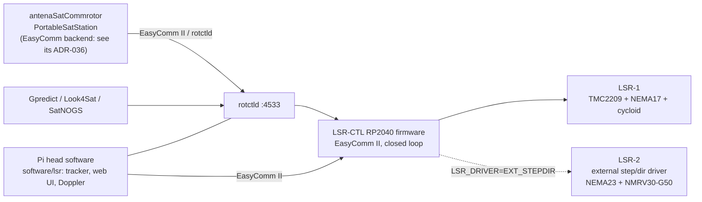
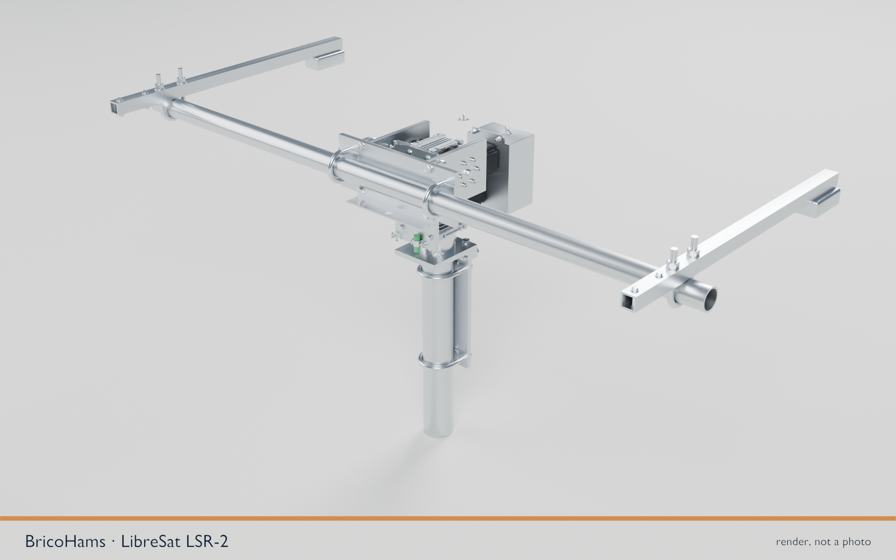
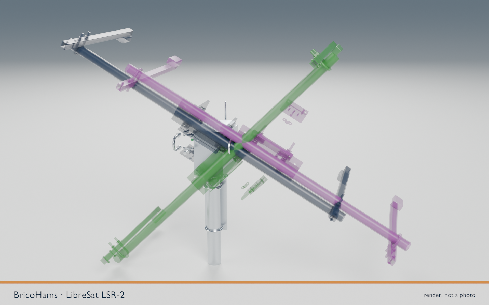
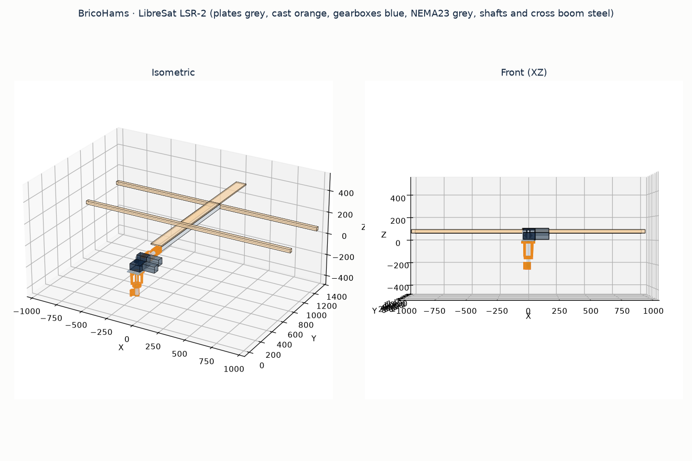
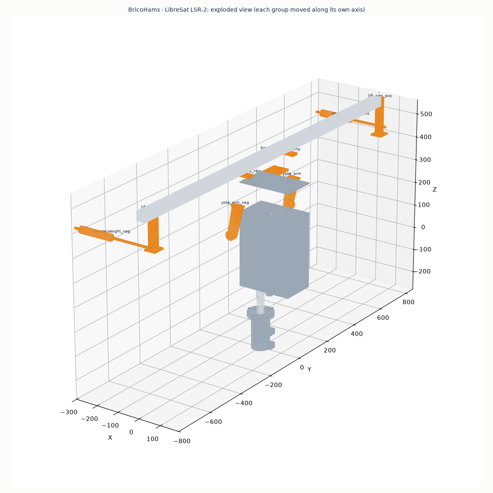

# BricoHams · LibreSat: rotor family architecture

**BricoHams · LibreSat**. Authors: Anatol EA5KAO, Diego EA5JEF, Pedro Roca Molina. Site: <https://bricohams.org>

## 1. Family overview

| | LSR-1 (exists) | LSR-2 (heavy station; default design = SARCTrac Mk4 replica, optional cast/CNC variant) |
|---|---|---|
| Use | portable, photo/survey tripod | fixed mast, 40–60 mm |
| Drive | printed cycloid 25:1 + NEMA17 | default (SARCTrac Mk4 replica): NMRV30-G50 worm 50:1 + NEMA23 23HS32-4004S; cast/CNC variant: NMRV030 80:1 + NEMA23 |
| Range | AZ 0–450° (cable wrap), EL 0–180° (flip) | Mk5-class: AZ ±360°, EL −30…150° (no flip) |
| Sensing | absolute EL (accelerometer), AZ index + saved position, AS5600 closed loop | AS5600 closed loop on each axis (J5/J7), photo-interrupter index per axis, saved position on power loss |
| Controller | LSR-CTL, internal TMC2209 | LSR-CTL (RP2040), step/dir to external DM542T drivers (`LSR_DRIVER=EXT_STEPDIR`); the Mk4 build also uses a Wemos D1 Mini Pro (ESP8266, WiFi) controller in a Deltron 483-0100 housing |
| Structure | printed PETG/ASA, metal only for pins, bearings and bolts | default (Mk4 replica): 10 mm aluminium plate, saddle plates and brackets, 2 mm laser-cut cover and enclosure with 16 mm corner blocks, 25 mm SHS lift arms, stainless hub, thrust bearing washer stack; optional cast/CNC variant: aluminium open-box body, cast A356-T6 (route A) or CNC 6082/6061 (route B) |
| Mass | ≈ 2.3 kg (ESTIMATE, rotator + controller) | **≈ 15.9 kg** (rotator head, electronics housing, lift arms, saddle and fasteners; without mast, antennas, cables and indoor PSU); generated by `calc/lsr2_mk4_bom.py`, see [BOM_LSR2](BOM_LSR2.md) |
| Cost | ≈ 150 € parts (Pi Zero 2 W) | **≈ 900 € (est.)**, EU hobby suppliers 2026, laser and CNC job prices are quotes to request; generated by `calc/lsr2_mk4_bom.py`, see [LSR2_MATERIALS](LSR2_MATERIALS.md) |
| Payload | light Yagi / SpaceQuad class | crossed Yagi pair 145/435 on the NMRV30-G50 (50:1); larger dishes need NMRV040/050 or a slewing drive ([LSR2_SIZING](LSR2_SIZING.md)) |

## 2. Shared stack

One firmware, one protocol and one head software drive both rotators.



- **LSR-CTL RP2040 firmware** (C/C++, Pico SDK). LSR-2 adds an external step/dir driver output, flag `LSR_DRIVER=EXT_STEPDIR` (compile on the target: [OPEN_ITEMS](OPEN_ITEMS.md) O24).
- **EasyComm II** is the common protocol (plus LSR extensions).
- **rotctld** on port 4533 serves Hamlib clients.
- **Pi head software** (`software/lsr`): tracker, web UI, Doppler. LSR-2 uses the rotator profile `lsr2` (`software/lsr/config.py`).
- **antenaSatCommrotor PortableSatStation** is a client of either rotator (EasyComm backend: its ADR-036).

## 3. LSR-2 mechanical architecture

Default design: the SARCTrac Mk4 replica built from the SARCNET FreeCAD files ([LSR2_MK4](LSR2_MK4.md)): 10 mm aluminium mounting plate, saddle plates and mast bracket, 2 mm laser-cut cover and electronics enclosure with 16 mm corner blocks, two NMRV30-G50 gearboxes with 23HS32-4004S motors, 25 mm SHS lift arms, stainless azimuth hub and thrust bearing washer stack. The phase 11 architecture (Mk5 schematic, §7d and §7e) is the optional cast/CNC variant. The phase-6 two-block layout is no longer part of the repository.



*Render, not a photo: the Mk4 head built from the SARCNET files.*


*Render, not a photo: the Mk4 replica exploded along the axes.*



*Render, not a photo: moving group of the Mk4 replica at EL -30°, 45° and 150°.*

Technical views of the Mk4 replica (matplotlib):






The Mk4 geometry is the SARCNET FreeCAD files (`third_party/sarctrac-mk4`, MIT), loaded by `cad/lsr2/mk4_build.py` with the parameters of `mk4_params.py`; the optional cast/CNC variant is generated by our own scripts (`cad/lsr2/body.py`, `axes.py`, `route_a.py`, `route_b.py`, `bought_parts.py`; parameters in `params.py`, `inputs.py`) and has one aluminium open box with a removable lid (layout, load path and cables in §7d). Structural checks (survival wind 100 km/h, crossed Yagi pair) are in `calc/lsr2_sizing.py` ([LSR2_SIZING](LSR2_SIZING.md), asserted by `--check`); allowable stress, modulus, preload and friction are VERIFY values. The masses used by the sizing (`cad/lsr2/inputs.py`) come from the same BOM and build report as the totals.

**Build checks** (`cad/lsr2/mk4_build.py`, variant: `build.py`): every solid valid; no interference above 1 mm³ between the made parts and the bought-part envelopes (report `interference`), EL sweep over −30..150° of the moving group; every made part of the report is a BOM row.

## 4. Design goal: light and cheap

Mass, cost and buy-in quantities have one source, `calc/lsr2_mk4_bom.py`: made-part masses come from the build report (`build/lsr2_build_report.json`), bought-part masses from catalogue values (est. where not catalogue). `calc/lsr2_materials.py` ([LSR2_MATERIALS](LSR2_MATERIALS.md)) and `scripts/bom.py` ([BOM_LSR2](BOM_LSR2.md)) print the same total (currently ≈ 15.9 kg without mast, antennas, cables and indoor PSU, ≈ 900 € est.; read the exact numbers there, they change with every geometry or price update). Prices are estimates (EU hobby suppliers, 2026); laser and CNC job prices are quotes to request.

## 5. Fabrication route

Default (Mk4): 2 mm 5754/5083 laser-cut sheet (cover, enclosure), 10 mm 6082 plate and 16 mm bar CNC-machined (plate, saddle plates, bracket, platform, corner blocks; [LSR2_ROUTE_B_CNC](LSR2_ROUTE_B_CNC.md) covers these plate parts), 25 x 25 x 2 SHS cut, stainless hubs turned. Assembly order: [LSR2_ASSEMBLY](LSR2_ASSEMBLY.md), bought parts and quantities: [BOM_LSR2](BOM_LSR2.md).

Optional cast/CNC variant, per part: route A (printed pattern → sand-cast A356-T6 → machining, [LSR2_ROUTE_A_CASTING](LSR2_ROUTE_A_CASTING.md)) or route B (3-axis CNC from a 6082/6061 block, [LSR2_ROUTE_B_CNC](LSR2_ROUTE_B_CNC.md)). Outputs: `cast/lsr2/` (patterns, core boxes), `cnc/lsr2/` (blanks, finished STEP), `cam/lsr2/` (setup sheets). If the FreeCAD route A/B derivation of the body hangs, an Autodesk Fusion alternative for the body and lid is in [LSR2_FUSION](LSR2_FUSION.md) (FreeCAD stays the reference); the fully constrained vertical-plate Mk5-style layout model is in [LSR2_FUSION](LSR2_FUSION.md#layout-model-vertical-plate-mk5-style-rotor-cadlsr2fusionlsr2_mk5_layoutpy). Shafts of the variant are turned stainless 1.4404 (STEP in `cnc/lsr2/`).


## 6. Build

```bash
make lsr2     # self-tests, then freecadcmd: body, lid, yoke, saddle, clamps, mast bracket, shafts (patterns, blanks, STEP/STL), assembly STEP, EL sweep check, build/lsr2_build_report.json
```

`scripts/render_lsr2_head.py` draws `img/lsr2_assembly.png`, `img/lsr2_exploded.png`, `img/lsr2_el_sweep.png`, `img/lsr2_castings.png` (route A) and `img/lsr2_blanks.png` (route B) from the STL files; `scripts/drawings.py` writes the dimensioned drawings to `docs/drawings/`. `build.py` does not delete files of removed parts: the stale list is in `docs/reference/STALE_FILES.txt`.

```bash
make render   # Blender 5.x Cycles: img/lsr2_hero.png, lsr2_head_closeup.png (Mk4 head, cover removed), lsr2_exploded_real.png, lsr2_laser_parts_real.png, lsr2_el_sweep_real.png (cast variant: lsr2_castings_real.png, lsr2_blanks_real.png)
```

`build.py` also writes `stl/lsr2/visual/` (visual models of the bought parts: NMRV030, NEMA23, drivers, bearings, mast, Yagis, fasteners), `cad/lsr2/LSR2_assembly.FCStd` / `.step` and `build/lsr2_render_scene.json` (EL axis, groups, categories, exploded offsets). `scripts/render_blender.py` reads them. Variables: `BLENDER`, `RENDER_OUT` (default `docs/img`; outside Documents on Windows with Controlled Folder Access), `RENDER_ARGS="--samples 64"`. The images are renders, not photos.

**Windows note.** If Controlled Folder Access blocks `freecadcmd` writing in Documents, set `LSR2_OUT` to a writable folder and copy `cnc/`, `cast/`, `stl/` and `build/` back.

## 7. Status and phases

| Phase | Content | Status |
|---|---|---|
| 1 | Spec, sizing calc, parameter file | done |
| 2 | CNC route: scripts, STEP, interference check (superseded by route B of phase 11) | done |
| 3 | Casting route, shafts, structural checks (superseded by route A of phase 11) | done (foundry quote and first casting pending) |
| 4 | Firmware `EXT_STEPDIR`, LSR-CTL header, `lsr2` profile | done; host tests pass, compile on the target open (O24), see [FIRMWARE](FIRMWARE.md) |
| 5 | BOM ([BOM_LSR2](BOM_LSR2.md)), assembly guide ([LSR2_ASSEMBLY](LSR2_ASSEMBLY.md)), `antenaSatCommrotor` rotctld backend (branch `feat/lsr-rotctld-backend` of Brico-Hams/antenaSatCommrotor), branding | done (backend lives in the other repository) |
| 6 | Two gearbox blocks and a square cross boom (replaced by phase 11) | superseded |
| 6b | Correction of the phase-6 boom layout (replaced by phase 11) | superseded |
| 6c | Aligned with the SARCTrac Mk5 data (SARCNET): drive at 400 microsteps/rev, power-loss save, photo-interrupter index, EasyComm II 9600, shim washers (see §7b) | done |
| 7 | Own two-half cast worm-gear housing LSR-WG30 with the SAME output-face PCD 65 pattern and hub (§7f) | done as an option; the bought NMRV030 stays the default |
| 8 | Automatic calibration and pointing model ([CALIBRATION](CALIBRATION.md), §7c) | done |
| 9 | Photoreal render pipeline (`make render`) and technical figures | done |
| 10 | Completeness audit: power budget, cable and gland fill, wiring diagram, acceptance checklist, [OPEN_ITEMS](OPEN_ITEMS.md) | done |
| 11 | Mk5-schematic architecture, routes A and B, deliverables (§7d, §7e) | done; now the optional cast/CNC variant (`LSR2_DESIGN=cast`); first casting, quotes and bench tests open |
| 12 | Mk4 replica (default design, `LSR2_DESIGN=mk4`): SARCNET Mk4 FreeCAD files (MIT, `third_party/sarctrac-mk4`), NMRV30 50:1, 23HS32-4004S, laser-cut cover, Wemos D1 Mini Pro controller ([LSR2_MK4](LSR2_MK4.md)) | done on paper; generators need a run, bench tests open |

Weather cover: in the Mk4 default the 2 mm laser-cut cover and the Deltron housing with glands protect the drives; in the cast/CNC variant the gasketed body, glands, breather and drain do (see [OPEN_ITEMS](OPEN_ITEMS.md), decisions taken).

**VERIFY before cutting metal or pouring** (the complete list with owner actions is [OPEN_ITEMS](OPEN_ITEMS.md)):
- NMRV030 dimensions: measure the real gearbox with a caliper and update `params.py`, then fit-test a 1:1 print;
- the keyed shaft torsion, the gearbox radial-load model and the EL bearing span;
- bearing, 51206 washer recess, circlip groove and U-bolt catalogue sizes against the real parts;
- A356-T6 yield (180 MPa in `inputs.py`, certificate of the foundry), modulus, U-bolt preload and friction, and the proof load of the first mast bracket;
- prices, yield and stock sizes in the materials budget (local quotes), and the foundry's pattern requirements;
- gearbox catalogue ratings with the supplier.

## 7b. Phase 6c: alignment with SARCTrac Mk5

LSR-2 adopts the facts published by SARCNET for the SARCTrac Mk5 ([reference data](reference/SARCTRAC_MK5_DATA.md); credit: SARCNET) unless a check of ours fails or the choice would make the rotator heavier or dearer without benefit. In the optional cast/CNC variant no SARCNET CAD or drawing geometry is used: that geometry is generated by our scripts. (The default Mk4 replica does use the SARCNET Mk4 FreeCAD files under the MIT licence, `third_party/sarctrac-mk4`.) Mk5 ambiguities in the source (160 vs 320 rpm, 128 kg vs 130 kg·m, 2.4 vs 5 GHz) are not relied on.

| Mk5 item | LSR-2 choice | why |
|---|---|---|
| AZ ±360°, EL −30…150°, 12°/s, shortest path | adopted | ranges and speed already match; the shortest-path slew planner stays |
| Anti-windup that unwinds the cable between passes | adopted as an option in `software/lsr` (`Limits.anti_windup`, planner and CLI), default off | the ±360° range is the cable limit; wiring it into the live tracker needs a one-line change in `tracker.py` (not touched in this phase), see [FIRMWARE](FIRMWARE.md) |
| 2 × NMRV30-G50 50:1 (Mk4 default; the cast/CNC variant uses NMRV030 80:1) | adopted | the SARCTrac Mk4 drive |
| 23HS32-4004S stepper (2.4 N·m, 4.0 A), 2 × DM542T (18-50 V) at 48 V, 400 microsteps/rev | adopted (`MICROSTEP = 2`, 666.7 steps/s at 12°/s with 50:1) | calc self-test and firmware test updated; 1/8 step is not needed at the output |
| S-400-48 supply | adopted (48 V, 8.3 A, Mk4 default) | 400 W covers 2 × 4 A with margin; PSU is mounted indoors and not in the head mass |
| 2 × XL7015 buck 48 V → 12 V and 5 V | adopted | cheap, removes a second supply |
| 3.3 → 5 V level converter for the DM542T opto inputs | adopted (4-channel module) | the DM542T opto inputs need ~5 V drive: "direct 3.3 V" wording removed |
| 48 V opto-isolated power-loss detect saving the position | adopted (`PIN_PWRFAIL`, firmware save-on-loss, host test) | cheap; needs ≥ 2200 µF bulk capacitance on the 48 V rail for the ~60 ms flash write (VERIFY on the bench) |
| Elecrow Pico W5 + Wi-Fi AP / Telnet | kept our LSR-CTL RP2040 board; Pico W5 approach documented as the alternative | LSR-CTL has the opto/level stage and connectors; the Pico W5 saves the Zero 2 W but gives no extra protection |
| EasyComm II 9600 8N1 | adopted as the LSR-2 default (`PI_BAUD`, profile baud) | Mk5 trackers (PstRotator, SatPC32, Orbitron, Gpredict) expect it |
| Photo-interrupter index, slotted disc per axis | adopted next to the AS5600 magnets (printed ASA discs, EE-SX1103-class sensors; homing and backlash calibration in firmware) | ~5 EUR and 25 g; gives a backlash-free repeatable reference without a hall magnet at the output |
| Thrust stack 51206 + M30×56×3 stainless shims | adopted: one washer replaces the old 3 mm ring, a second adjusts the preload (circlip 1.5 + 2 × 3 = 7.5 mm of the 10 mm gap, checked in calc) | standard part, cheaper than a turned ring |
| Mk5 load path (gearbox output bearings carry the overturning moment) | kept our bearing pair + 51206 in the body pillar | the sizing shows the gearbox output bearings allow about 38 N·m, below the survival moment of any payload ([LSR2_SIZING](LSR2_SIZING.md)) |
| M14 stainless threaded rod + 5×8 roll pins as EL shaft | kept the turned keyed Ø30/Ø14 shaft | one-sided boom: the rod fails the von Mises check at the outer bearing (calc `mk5_options`) |
| M14 rod + roll pins as AZ shaft | kept the turned shaft | the AZ shaft is a Ø30/Ø14 piece with the bearing seats and the circlip groove: no saving from a rod |
| Galvanised angle brackets for the mast platform / boom socket | "budget build" variant only (separate BOM section, not in the totals) | not covered by the calc, galvanic corrosion with Al/stainless on the coast, steel is heavier than the cast parts |
| Thrust-bearing seal (PVC pipe + silicone) | our V-ring + housing recess; inspection interval in [LSR2_ASSEMBLY](LSR2_ASSEMBLY.md) | no extra part; same inspection routine |
| Tef-Gel on dissimilar-metal joints | adopted everywhere (BOM, assembly) | corrosion rule |

## 7c. Calibration, correction and control (Phase 8)

Head-side software ([CALIBRATION](CALIBRATION.md)); the RP2040 only exposes raw data (`XR`) and keeps its own index, backlash and slip logic from Phase 6c.

- **Why Sun calibration beats the compass.** The Sun's position is known to ~0.01° from GPS time and position, it needs no extra hardware and no declination model, and it is not disturbed by the motors, steel tripod or coax. A magnetometer next to NEMA motors and a ferrous mast has several degrees of error, and the declination is only good to ~0.5°. The MPU-6050 has no magnetometer, so the compass step is optional and the Sun is the reference. The compass remains useful for a first guess in the dark.
- **Why a pointing model.** A mount has a handful of small, stable errors: north offset, horizon offset, tilt, axis non-perpendicularity, boresight, encoder eccentricity, backlash. Measuring a few dozen points once and fitting those few terms by least squares removes them for the whole sky, which is cheaper and more accurate than building the mechanics to 0.1°. The residual RMS is the acceptance number. Commanded positions go sky → mount, reported positions mount → sky, so Gpredict, rotctld and the tracker never see the correction.
- **Why closed loop on the output encoders.** The step count only says where the motor was told to be. The AS5600 on the output sees lost steps, a stall (no motion while commanded) and backlash. Comparing the two gives step-loss re-sync and a stall stop with a clear fault, and a small encoder trim after each move. The deadband avoids hunting.
- **Safe by default.** `pointing.enabled` and `control.enabled` are false; the rotator then runs unmodified. Invalid calibration values are ignored. A latched fault (stall, missing GPS/IMU/encoder when required) stops the motion and is reported in the web UI and in rotctld `\dump_state`.
- **Software architecture.** `CorrectedRotator` wraps `Rotator`/`SimRotator`: tracker and rotctld are unchanged. Least squares is plain Python (`lsq.py`), no numpy.

Credit: the structure of this chain (level → north → Sun → index/backlash → pointing terms → closed loop) follows ideas from the SARCNET MK1 derivatives and Rotator7. No external code is used.

## 7d. Phase 11 (11b): Mk5-schematic architecture (optional cast/CNC variant)

This section and §7e document the optional cast/CNC variant (`LSR2_DESIGN=cast`), not the default Mk4 replica. Replaces the phase-6 two-block layout. Binding brief: `reference/BRICOHAMS_LSR2_BRIEF.md`. Frame: origin at the body bottom face, AZ = z, EL = horizontal y, boresight x. Every number is DATASHEET / MEASURE / PARAMETRIC in `cad/lsr2/inputs.py`, `axes.py`, `body.py`, `cables.py`.

- **Body** (`body.py`): aluminium open box (5 mm walls and ribs from `params.CAST`), removable lid with gasket groove, AZ pillar low, EL gearbox high on the +y wall, both motors inside on the same side, drivers on the −y inner wall pad (thermal path through the wall and external ribs), glands and drain at the bottom, breather and BricoHams nameplate recess on the front face. One finished solid serves casting (route A) and CNC (route B).
- **Layout** (`layout_study.py` → `LSR2_LAYOUT_STUDY.md`): A parallel stacked vs B staggered motors; A chosen (most compact, driver heat within limit, EL sweep −30…150 clear of the body with a forward-offset narrow saddle).
- **AZ** (`axes.py`): Ø30 shaft on 2×6206 + 51206 in the pillar; the gearbox transmits torque only (coupling by key). Mast split-clamp bracket with labyrinth cup under the skirt. Index disc inside the pillar.
- **EL**: Ø20 through-shaft on two 6004 in the side walls, torque coupling to the gearbox; two yoke arms (U) → saddle → two boom clamp blocks → cross boom Ø40 (1.6 m) → lift arms with antennas and sliding counterweights at the ends.
- **Load path**: antenna → lift arm → boom → clamps → saddle → yoke arms → EL shaft/bearings → body walls → AZ pillar (radial 2×6206, axial 51206) → mast bracket → mast. Gearboxes see torque only.
- **Cables**: coax clock-spring coils at the EL bearings, harness wrap around the mast bracket (`cables.py`, gland fill in [LSR2_SIZING](LSR2_SIZING.md) §16); the AZ shaft is solid, no cable bore; bend radius ≥ 10×OD; stops (EL pin on the arm, AZ software limit + index sensor); AZ wrap vs slip ring is an open decision.
- **Sealing**: lid gasket, shaft seals, glands with drip loop, breather and drain; IP target defined but **to be tested** (no IP claim).
- **Noise (VHF/UHF)**: shielded motor/driver cables with ferrites, driver chopping frequency kept off the 144/435 MHz harmonics, drivers separated from the coax path inside the body; to be measured.
- **Manufacturing routes (11c/11d)**: every structural part (body, lid, mast bracket, yoke arm, saddle, boom clamp) has route A, printed pattern → sand-cast A356-T6 → machining ([LSR2_ROUTE_A_CASTING](LSR2_ROUTE_A_CASTING.md), `route_a.py`) and route B, 3-axis CNC from 6082/6061 block ([LSR2_ROUTE_B_CNC](LSR2_ROUTE_B_CNC.md), `route_b.py`, `cam/lsr2/<part>_setups.csv`). `calc/lsr2_materials.py` compares both per part; `bom_lsr2.yaml` lists both and the BOM takes the cheaper as default.
- **Status**: geometry, both routes, materials, BOM and the 11e deliverables written; mass/CG feedback (>10 % → update `inputs.py`) is applied from the build report.

## 7e. Phase 11e: deliverables and tests

| Deliverable | Where |
|---|---|
| Parametric FreeCAD assembly (Bought / Machined / Cast / Printed_pattern groups, labels = BOM Pos, spreadsheet `Params`) and whole-assembly STEP | `cad/lsr2/LSR2_assembly.FCStd`, `LSR2_assembly.step.zip` (`assembly_doc.py`, balloon table `parts_table.py`) |
| Dimensioned drawings: per part and assembly (front, side, top, sections through the AZ and EL axes), exploded view with BOM balloons, legend, title block | `docs/drawings/*.svg`, `*.pdf` (`scripts/drawings.py`) |
| Tolerances (datums, ISO fits, finishes, justification by mating part and process) | [LSR2_TOLERANCES](LSR2_TOLERANCES.md), generated from `cad/lsr2/tolerances.py` |
| Inspection sheet (empty result column) | [LSR2_INSPECTION](LSR2_INSPECTION.md) |
| Risk review | [LSR2_RISKS](LSR2_RISKS.md) |
| Assembly guide (order, torques, fitting, coupling, balance, cabling) | [LSR2_ASSEMBLY](LSR2_ASSEMBLY.md); wiring in [ELECTRONICS](ELECTRONICS.md) and `docs/drawings/LSR2_wiring.svg` (`scripts/wiring.py`) |
| Power budget and cable/gland fill | [LSR2_SIZING](LSR2_SIZING.md) §15–16 |
| Acceptance checklist and open items | [LSR2_ACCEPTANCE](LSR2_ACCEPTANCE.md), [OPEN_ITEMS](OPEN_ITEMS.md) |
| Progressive bench test plan and results table | [LSR2_TEST_PLAN](LSR2_TEST_PLAN.md) |
| Technical figures and photoreal renders | `docs/img/` (`render_lsr2_head.py`, `render_blender.py`) |

The spreadsheet documents the key numbers of `axes.py`, `params.py` and `inputs.py`; the shapes are generated, so a change of a number is made in the Python source and `make lsr2` regenerates the document. The BOM gets a Pos column with the same balloon numbers.

## 7f. Phase 7: own worm gearbox LSR-WG30

| Decision | Value | Tag |
|---|---|---|
| Interfaces | identical to `NMRV030_GEO`: PCD 65 4×M6 faces, Ø14 H8 keyed hollow output, hub 63, Ø55 boss, NEMA23 flange | DATASHEET |
| Selector | `GEARBOX_SOURCE` = `nmrv030` (default) or `lsr_wg30` (env `LSR2_GEARBOX`); with `lsr_wg30` the envelopes become the real housing solids and the interference and EL sweep checks must still pass | PARAMETRIC |
| Housing | A356, two halves split on the wheel mid-plane, M5 screws + 2 Ø5 dowels + gasket groove, fins under the worm, patterns, core and core box generated by route A | PARAMETRIC |
| Gear set | worm Ø20 q40, m0.5, z1 = 1, z2 = 80, a = m(q+z2)/2 = 30 mm exactly (the NEMA flange fixes a, so a two-stage drop-in is infeasible) | PARAMETRIC |
| Lead angle | 1.43°; self-locking with μ ≤ 0.1 (lock factor 2.1 at μ 0.05) | VERIFY μ |
| Efficiency | 0.32 running (μ 0.05), 0.19 holding; motor check 2.16 N·m × 0.8 × 80 × 0.32 = 44 N·m still passes | PARAMETRIC |
| Bearings | wheel carrier 2 × 61905, worm 2 × 6003, lip seals TC 25×42×7 and TC 17×30×7; the EL gearbox sees torque only | VERIFY catalogue |
| Duty | ≤ 10 % at satellite duty; thermal not critical (grease, natural convection) | PARAMETRIC |

Capacity (calc/lsr2_sizing.py section LSR-WG30, tooth bending with Lewis form factor, CuSn12 allowable VERIFY, surface durability): about 3 N·m fatigue, 8.6 N·m static and 7.8 N·m surface against the 16.7 N·m NMRV030 rating (peak 33.4 N·m), so the unit is about 5× short at a = 30 mm. Capacity scales with a³: parity needs a ≈ 53 mm, which breaks the drop-in. The rows only gate the check when `GEARBOX_SOURCE = 'lsr_wg30'`.

Cost comparison (generated in [LSR2_MATERIALS](LSR2_MATERIALS.md), prices VERIFY): own unit about 60 EUR variable (metal 9, machining 14, gear set 25, bearings/seals/hardware 13) plus fixed batch cost, against 55 EUR bought, so no break-even exists at any batch. **Recommendation: keep the bought NMRV030**; LSR-WG30 becomes interesting only with a cheaper gear set, a larger-centre redesign or a batch with free machining.

Open decisions (VERIFY / MEASURE): (1) joint screws only on the −y side (4 M5); (2) worm bore wall about 3 mm and tube seat wall 4.5 mm (< casting minimum 5); (3) cantilever worm core needs a chaplet or two-piece core; (4) face-hole edge wall 4.5 mm; (5) fin thickness 4 mm against 3 mm on the envelope (may touch neighbours); (6) disc lightening and hot-spot riser or chill (foundry to confirm); (7) tooth form is not modelled (visual solids only), tooth flank and mesh clearance are bought-pair data; (8) the capacity shortfall above.

Stale phase-6 files to delete: `cad/lsr2/plates.py`, `cad/lsr2/cast_parts.py`, `cad/lsr2/visual_parts.py`.

## 8. Credits

The default LSR-2 design is a replica of the SARCNET SARCTrac Mk4 and uses the SARCNET FreeCAD files under the MIT licence (`third_party/sarctrac-mk4`, confirmation in its PROVENANCE.md; see [LSR2_MK4](LSR2_MK4.md)). The architecture of the optional cast/CNC variant is inspired by the SARCNET SARCTrac Mk5; there no SARCNET file or geometry is used. Credits: SARCNET (SARCTrac Mk4 FreeCAD files, MIT; Mk5 published data). See [DESIGN_ANALYSIS](DESIGN_ANALYSIS.md) §5 and the [spec](superpowers/specs/2026-11-16-lsr2-heavy-rotator-design.md).
