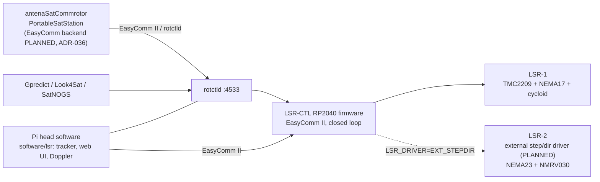
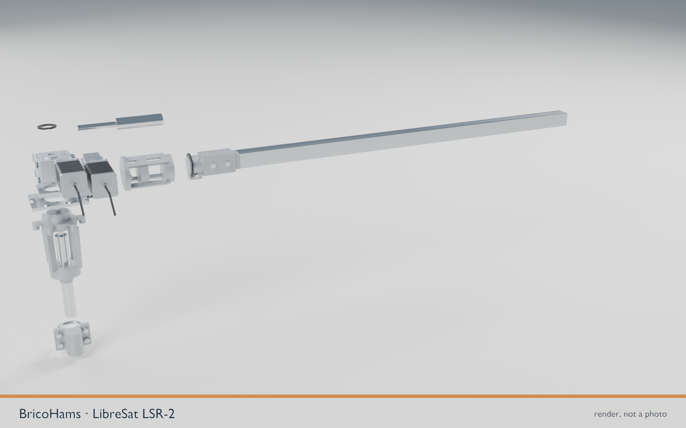
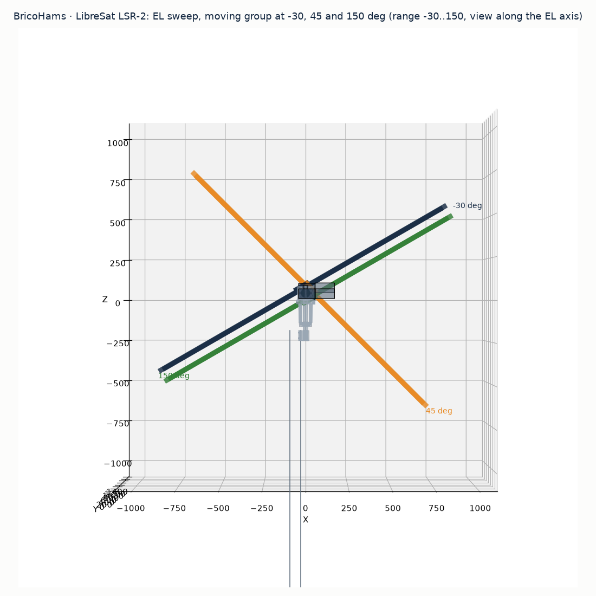

# BricoHams · LibreSat: rotor family architecture

**BricoHams · LibreSat**. Authors: Anatol EA5KAO, Diego EA5JEF, Pedro Roca Molina. Site: <https://bricohams.org>

## 1. Family overview

| | LSR-1 (exists) | LSR-2 (heavy station, mechanics built) |
|---|---|---|
| Use | portable, photo/survey tripod | fixed mast, 40–60 mm |
| Drive | printed cycloid 25:1 + NEMA17 | NMRV030 worm 80:1 + NEMA23 |
| Range | AZ 0–450° (cable wrap), EL 0–180° (flip) | Mk5-class: AZ ±360°, EL −30…150° (PLANNED; no flip, out of scope) |
| Sensing | absolute EL (accelerometer), AZ index + saved position, AS5600 closed loop | absolute magnetic encoder on each **output** shaft (AS5048A/AS5600), index kept as cross-check (PLANNED) |
| Controller | LSR-CTL, internal TMC2209 | LSR-CTL, step/dir to external drivers DM542 or TMC5160 (PLANNED) |
| Structure | printed PETG/ASA, metal only for pins, bearings and bolts | CNC 6061-T6/5083 plates (8 mm, top 6 mm) + cast A356 parts |
| Mass | ≈ 2.3 kg (ESTIMATE, rotator + controller) | see [LSR2_MATERIALS](LSR2_MATERIALS.md) (ESTIMATE) |
| Cost | ≈ 150 € parts (Pi Zero 2 W) | see [LSR2_MATERIALS](LSR2_MATERIALS.md) (ESTIMATE, VERIFY) |
| Payload | light Yagi / SpaceQuad class | crossed Yagi pair 145/435 on NMRV030; larger dishes need NMRV040/050 or a slewing drive ([LSR2_SIZING](LSR2_SIZING.md)) |

## 2. Shared stack

One firmware, one protocol and one head software drive both rotators.



- **LSR-CTL RP2040 firmware** (C/C++, Pico SDK). LSR-2 adds an external step/dir driver output, flag `LSR_DRIVER=EXT_STEPDIR` (PLANNED).
- **EasyComm II** is the common protocol (plus LSR extensions).
- **rotctld** on port 4533 serves Hamlib clients.
- **Pi head software** (`software/lsr`): tracker, web UI, Doppler. LSR-2 uses a rotator profile `lsr2` (PLANNED).
- **antenaSatCommrotor PortableSatStation** is a client of either rotator. Its EasyComm backend is PLANNED (see its ADR-036).

## 3. LSR-2 mechanical architecture


*Render, not a photo: the head as built from `cad/lsr2/` (bought parts are visual models).*



*Render, not a photo: exploded along the axes.*


*Render, not a photo: moving group at EL -30°, 45° and 150°.*

Technical views (matplotlib):




Geometry is generated by our own scripts (`cad/lsr2/plates.py` for the plates, `cad/lsr2/cast_parts.py` for the cast parts and shafts, parameters in `cad/lsr2/params.py`). Phase 6 replaced the plate box (two side plates, a top plate and a second spacer) by two compact gearbox blocks.

**Two-block layout.** Two NMRV030 worm gearboxes stand side by side on one small base plate. Each NEMA23 is bolted straight onto its gearbox input flange. Both worm axes run along X and both motors point +X, parallel (as in the owner's reference photo). The AZ gearbox has its output face down on the spacer, with the AZ shaft going up into its hub. The EL gearbox has its output axis horizontal (Y): output face A sits on the small upright `el_bracket`, and its other output face B carries the `el_bearing_housing`. The EL shaft runs through the gearbox hub (Ø14, torque only), through the two 6206 of the `el_bearing_housing` (Ø30) and ends in the `boom_socket`. The socket holds a square 6063 cross-boom tube (40 × 40 × 3, 1100 mm, VERIFY) **along +Y, coaxial with the EL axis**, one-sided; the antennas sit on the tube at 0.45 and 0.95 m from the socket (`ANT_POS_Y`, VERIFY). A flanged DIN 705 collar (bought, cheaper than a turned disc) retains the AZ gearbox hub on the shaft top. A printed ASA weather cover is a future option.

**Head frame (mm).** The AZ axis is Z through the origin. The top face of the base plate is at z = 0. The EL axis runs along Y at x = 0 and z = EL_Z = 40 (the EL gearbox stands on the base plate). The EL range is −30..150°.

| Plate | Size / t (mm) | Role |
|---|---|---|
| `base` | 110 × 134, 8 | carries both gearboxes; PCD 110 holes for the cast AZ housing; rotates with the head |
| `spacer` | 80 × 80, 8 | lifts the AZ gearbox so the NEMA23 clears the base |
| `el_bracket` | 96 × 80, 8 | upright; EL gearbox output face A (PCD 65); bolted to the base edge with 4 × M6 into its tapped bottom edge |

No plate has lightening holes: the rule in `params.LIGHTEN` leaves no room on parts this small. Joint tilt of the bracket under the EL moment is not calculated: proof-load the first unit (VERIFY).

**Cast parts (A356-T6, sand cast, then machined).** Details in `cad/lsr2/cast_parts.py`.

| Part | Role | Form |
|---|---|---|
| `az_housing` | holds the AZ radial bearing pair and the 51206; bolts under the base plate (6 × M6 on PCD 110) | two short bearing rings joined by 4 ribs (open window between the seats) and 6 bolt lugs; the two ring bores are cored |
| `mast_clamp` | stationary; clamps the AZ shaft bottom and the mast (40–60 mm) | bore cast solid and bored; 90° V groove with ears for 2 M8 U-bolts |
| `el_bearing_housing` | PCD 65 flange on the EL gearbox output face B (4 × M6), 4 ribs at 45° and two bearing rings (2 × 6206, 62 mm apart); the bolt heads are reached with a ball-end hex key through the side windows | flange + 2 rings + 4 ribs, recess for the gearbox boss, bores cast solid |
| `boom_socket` | keyed (key 8) Ø30 hub on the EL shaft end with a pinch slit + M6, then a 40.5 × 40.5 × 80 deep square socket for the tube, 2 × M8 through-bolts (tube drilled at assembly). One cast part replaces hub + plate + 2 clamp plates, cheaper and lighter than a CNC end plate with 2 angle brackets | cored prismatic pocket (one sand core), bore cast solid |

**Shafts (turned stainless 1.4404).** `az_shaft`: Ø30 bearing seats and mast-clamp end, Ø14 h7 × 80 keyed top into the NMRV030 hollow output and the retaining collar. It is **hollow**: Ø16 bore from the bottom end that stops below the Ø14 step, so the keyed top stays solid. There is no integral collar: the 51206 shaft washer rests on a bought DIN 471 circlip + M30×56×3 stainless washer (the Mk5 shim, SARCNET) (cheaper than a DIN 705 set collar and it fits the 10 mm gap), so the bar is Ø30 + 3 mm. `el_shaft`: Ø14 h7 through the gearbox hub (key 5, torque only) and 37 mm beyond it, Ø30 through the two 6206 (circlips) to the `boom_socket` hub (key 8 × 7).

**AZ load path.** An external pair of 6206 bearings (120 mm apart) plus a 51206 thrust bearing, in the cast housing, carry the overturning moment. The NMRV030 gearbox carries only **torque** through the keyed shaft. The AZ shaft is stationary and clamped to the mast by `mast_clamp` (Ø6 cross pin for the torque, M8 U-bolts and the V groove for the mast); the housing, plates and head rotate round it. The sizing shows the gearbox output bearings alone allow 38 N·m, below the survival overturning moment of every listed payload (60 N·m for a crossed Yagi pair).

**Cable route.** The rotator cables enter the bottom of the hollow AZ shaft, rise up the Ø16 bore and leave through a Ø6 radial hole at z = −4 mm, inside the base plate hole just above the upper bearing. They only twist (±360°) on the AZ axis, with no wrap round the mast. An M20 gland in the mast clamp does not fit (10 mm of free bore, walls < 5 mm), so the cables leave the open bore end. VERIFY and still to do: a cable slot in `spacer` from the base plate hole to the head, and cables passing beside the Ø6 cross pin.

**EL shaft.** The EL gearbox hub drives the shaft (torque only). With the boom one-sided along the EL axis the antenna weight and wind make a bending moment that a Ø14 hub section cannot carry, so, as on AZ, the `el_bearing_housing` carries it in two 6206 62 mm apart on a Ø30 section; the gearbox output bearings only see a small misalignment load (< 20 % of fr2, checked). The EL axis is 40 mm above the base plate (`EL_AXIS_HEIGHT` in `params.py` gives the lever above the upper AZ bearing for the sizing).

**Structural checks** (`calc/lsr2_sizing.py`, survival wind 100 km/h, crossed Yagi pair; table in [LSR2_SIZING](LSR2_SIZING.md), asserted by `--check`):
- `az_housing` ribs: axial force from the couple, bending from the bearing shear and Euler buckling (K = 0.5) against the A356-T6 allowable, safety factor ≥ 3. The first design (6 mm ribs) failed, so the ribs are 8 mm thick and wider (`RIB_T`, `RIB_R_IN`, `RIB_R_OUT`);
- `mast_clamp`: U-bolt tension from the overturning moment at the clamp, bending of the V arms and the friction torque of the U-bolts against the gearbox standstill torque, safety factor ≥ 2. The 6 mm arms failed, so they are **11 mm** (the ear nut face follows the arm's outer line). Preload bending of the arms is not covered: proof-load the first casting (VERIFY);
- EL head (phase 6b): shaft Ø30 at the outer bearing (bending from weight + survival wind of the Yagi pair at `ANT_POS_Y`, plus torsion, von Mises, 1.4404 yield 200 MPa VERIFY, SF ≥ 2), static s0 ≥ 2 on the more loaded 6206, gearbox output radial load from misalignment/flex < 0.2 fr2, housing ribs and M6 bolts, and the tube at the socket mouth. Keyways, the keyed Ø14 torsion (SF about 2) and fatigue are not covered (VERIFY).

**Build checks** (`cad/lsr2/build.py`): every solid valid; no interference above 1 mm³ between plates, cast parts, shafts and envelopes except the explicit fits (shaft in gearbox, bearing seat, hub, collar); the EL sweep over −30..150° (every 5°) of the socket, cross-boom tube and the two Yagi envelopes (2 m boom, 1 m elements) against the head, the `az_housing`, the mast clamp and a Ø60 mast envelope 1.5 m down; patterns bigger than parts by shrink and allowance.

Allowable stress, modulus, preload (8 kN per M8 U-bolt) and friction (0.2) are VERIFY values; the current numbers and safety factors are in [LSR2_SIZING](LSR2_SIZING.md).

## 4. Design goal: light and cheap

Numbers from [LSR2_MATERIALS](LSR2_MATERIALS.md) (generated by `calc/lsr2_materials.py`; prices and yield are generic, VERIFY). Phase 6 has 6 plates of about 0.7 kg finished in total (old plate box: 4.55 kg) and no lightening holes. Plate stock, cast parts, shafts, bought parts, the finished head mass and the totals change with every geometry update: read them in [LSR2_MATERIALS](LSR2_MATERIALS.md) and [BOM_LSR2](BOM_LSR2.md). Buying cut-to-size blanks instead of full sheets cuts the plate waste and the cost. The AZ shaft is hollow and collar-free to save stainless mass and cost.

## 5. Fabrication route

1. **PLA 1:1 prototype** of all plates for a fit test (or MDF from the DXF). STL in `stl/lsr2/`.
2. **CNC plates** in 6061-T6 or 5083, 8–10 mm: DXF and STEP in `cnc/lsr2/`.
3. **PLA patterns and core box** for the cast parts (STEP/STL in `cast/lsr2/` and `stl/lsr2/`, shown in `img/lsr2_patterns.png`). Patterns are scaled for shrinkage (1.013), have a 2.5 mm machining allowance on machined faces and core prints where needed. Draft is modelled only on the revolved housing (2° outside, 3° on cores); prismatic ribs, strips and blocks get 2° from the pattern maker.
4. **Sand-cast A356** parts at a foundry, then machined. Parting notes (`PARTING` in `cast_parts.py`):
   - `az_housing`: parting plane z = −8 (flange face, flat), single drag half, all outer draft opens towards the flange; core A on the flange face (cope), core B through the lip hole (drag); both ring bores are cored from `az_housing_corebox`;
   - `mast_clamp`: parting plane z = −175 (boss top), drag only, bore cast solid;
   - `el_bearing_housing`: parting plane at the flange face, body in the drag, bores cast solid;
   - `boom_socket`: parting plane at the mouth face, hub up, pocket cored by one prismatic core, bore cast solid and slit sawn.
5. **Turned stainless shafts** from Ø33 bar (`az_shaft`: hollow, bore Ø16 gun-drilled from the bottom end, VERIFY with the machinist) and Ø23 bar (`el_shaft`); STEP in `cnc/lsr2/`.
6. **Bought small parts**: DIN 471 Ø30 circlip + M30×56×3 stainless washer shim(s) under the 51206 (Mk5, SARCNET), 2 M8 U-bolts (A4-80 or 8.8), 4 × 6206 bearings (AZ and EL pairs), V-rings, DIN 705 Ø14 flanged collar, circlips (DIN 471 Ø30, DIN 472 Ø62), cross-boom tube, 2 × M8 through-bolts, keys (list and prices in [LSR2_MATERIALS](LSR2_MATERIALS.md); full BOM in [BOM_LSR2](BOM_LSR2.md)).
7. **Assembly**: step by step in [LSR2_ASSEMBLY](LSR2_ASSEMBLY.md).

## 6. Build

```bash
make lsr2     # self-tests, then freecadcmd: plates, cast parts, patterns, core box and shafts (DXF/STEP/STL), assembly STEP, EL sweep check, build/lsr2_build_report.json
```

`scripts/render_lsr2.py` draws `img/lsr2_assembly.png`, `img/lsr2_exploded.png`, `img/lsr2_patterns.png` and `img/lsr2_el_sweep.png` from the STL files. `build.py` does not delete files of removed parts: remove stale `side_a`, `side_b`, `top`, `spacer_el` and `el_hub*` files by hand.

```bash
make render   # Blender 5.x Cycles: img/lsr2_hero.png, lsr2_head_closeup.png, lsr2_exploded_real.png, lsr2_castings_real.png, lsr2_el_sweep_real.png, lsr2_calibration.png
```

`build.py` also writes `stl/lsr2/visual/` (finer copies of the fabricated parts and visual-only models of the NMRV030, NEMA23, mast, Yagis and fasteners; the checks keep the simple envelopes) and `build/lsr2_render_scene.json` (EL axis, groups, exploded offsets). `scripts/render_blender.py` reads both. Variables: `BLENDER`, `RENDER_OUT` (default `docs/img`; outside Documents on Windows with Controlled Folder Access), `RENDER_ARGS="--samples 64"`. The images are renders, not photos.

**Windows note.** If Controlled Folder Access blocks `freecadcmd` writing in Documents, set `LSR2_OUT` to a writable folder and copy `cnc/`, `cast/`, `stl/` and `build/` back.

## 7. Status and phases

| Phase | Content | Status |
|---|---|---|
| 1 | Spec, sizing calc, parameter file | done |
| 2 | CNC plates: scripts, DXF, STEP, interference check | done for plates (printed/MDF fit test pending) |
| 3 | Cast parts, patterns, core box, shafts, structural checks | done (foundry quote and first casting pending) |
| 4 | Firmware `EXT_STEPDIR`, LSR-CTL header, `lsr2` profile | in progress, see [FIRMWARE](FIRMWARE.md) |
| 5 | BOM ([BOM_LSR2](BOM_LSR2.md)), assembly guide ([LSR2_ASSEMBLY](LSR2_ASSEMBLY.md)), `antenaSatCommrotor` rotctld backend (branch `feat/lsr-rotctld-backend` of Brico-Hams/antenaSatCommrotor), branding | documentation done; backend in progress |
| 6 | Phase 6 replaced the plate box by two gearbox blocks and a square cross boom | geometry and checks written; build, renders and first fit pending |
| 6b | Correction: boom along the EL axis in a cast `boom_socket`; EL bearing pair (2 × 6206) in `el_bearing_housing`; cut-to-size plates; BOM masses read from the build report | geometry and checks written; build pending |
| 6c | Aligned with the SARCTrac Mk5 data (SARCNET): drive at 400 microsteps/rev, power-loss save, photo-interrupter index + printed ASA discs, EasyComm II 9600, shim washers (see §7b) | written; build and tests pending |
| 7 | PLANNED: our own two-half cast worm-gear housing replaces the bought NMRV030 housings, with the SAME output-face PCD 65 pattern and hub, so all phase 6 parts stay compatible | planned |

Future: printed ASA weather cover (not in phase 6).

**VERIFY before cutting metal or pouring:**
- NMRV030 dimensions: measure the real gearbox with a caliper and update `params.py`, then fit-test the 1:1 print; the gearbox boss against the Ø52 recess in `el_bearing_housing`;
- joint tilt of `el_bracket` on the base plate (not calculated), the keyed Ø14 section torsion (SF about 2), the gearbox radial-load model and the EL bearing span;
- bearing, 51206 washer recess, circlip and U-bolt catalogue sizes against the real parts;
- A356-T6 allowable (80 MPa), modulus, U-bolt preload and friction, and the proof load of the first mast clamp;
- gun drilling of the Ø16 bore, the cable slot in `spacer` and the cable passage beside the cross pin;
- prices, yield and sheet size in the materials budget (local quotes), and the foundry's pattern requirements;
- gearbox catalogue ratings with the supplier.

## 7b. Phase 6c: alignment with SARCTrac Mk5

LSR-2 adopts the facts published by SARCNET for the SARCTrac Mk5 ([reference data](reference/SARCTRAC_MK5_DATA.md); credit: SARCNET) unless a check of ours fails or the choice would make the rotator heavier or dearer without benefit. No SARCNET CAD or drawing geometry is used: our geometry is generated by our scripts. Mk5 ambiguities in the source (160 vs 320 rpm, 128 kg vs 130 kg·m, 2.4 vs 5 GHz) are not relied on.

| Mk5 item | LSR-2 choice | why |
|---|---|---|
| AZ ±360°, EL −30…150°, 12°/s, shortest path | adopted | ranges and speed already match; the shortest-path slew planner stays |
| Anti-windup that unwinds the cable between passes | adopted as an option in `software/lsr` (`Limits.anti_windup`, planner and CLI), default off | the ±360° range is the cable limit; wiring it into the live tracker needs a one-line change in `tracker.py` (not touched in this phase), see [FIRMWARE](FIRMWARE.md) |
| 2 × NMRV030 80:1 | adopted | already the LSR-2 drive |
| 57BYG250H-8 stepper, 2 × DM542 at 48 V, 400 microsteps/rev | adopted (`MICROSTEP = 2`, 1066.7 steps/s at 12°/s) | calc self-test and firmware test updated; 1/8 step is not needed at the output (0.0045°/step at 400 µsteps/rev) |
| S-400-48 supply | kept our 48 V 6 A supply; S-400-48 listed as the alternative | 288 W covers 2 × 3 A with margin; the S-400-48 is dearer (~45 vs 25 EUR) and 0.5 kg heavier without benefit |
| XL7015 buck 48 V → 5 V | adopted | cheap, removes a second supply |
| 3.3 → 5 V level converter for the DM542 opto inputs | adopted (4-channel module) | the DM542 opto inputs need ~5 V drive: "direct 3.3 V" wording removed |
| 48 V opto-isolated power-loss detect saving the position | adopted (`PIN_PWRFAIL`, firmware save-on-loss, host test) | cheap; needs ≥ 2200 µF bulk capacitance on the 48 V rail for the ~60 ms flash write (VERIFY on the bench) |
| Elecrow Pico W5 + Wi-Fi AP / Telnet | kept our LSR-CTL RP2040 board; Pico W5 approach documented as the alternative | LSR-CTL has the opto/level stage and connectors; the Pico W5 saves the Zero 2 W but gives no extra protection |
| EasyComm II 9600 8N1 | adopted as the LSR-2 default (`PI_BAUD`, profile baud) | Mk5 trackers (PstRotator, SatPC32, Orbitron, Gpredict) expect it |
| Photo-interrupter index, slotted disc per axis | adopted next to the AS5600 magnets (printed ASA discs, EE-SX1103-class sensors; homing and backlash calibration in firmware) | ~5 EUR and 25 g; gives a backlash-free repeatable reference without a hall magnet at the output |
| Thrust stack 51206 + M30×56×3 stainless shims | adopted: one washer replaces the old 3 mm ring, a second adjusts the preload (circlip 1.5 + 2 × 3 = 7.5 mm of the 10 mm gap, checked in calc) | standard part, cheaper than a turned ring |
| Mk5 load path (gearbox output bearings carry the overturning moment) | kept our cast `az_housing` with the 6206 pair + 51206 | the sizing shows the gearbox output bearings allow about 38 N·m, below the survival moment of any payload ([LSR2_SIZING](LSR2_SIZING.md)) |
| M14 stainless threaded rod + 5×8 roll pins as EL shaft | kept the turned keyed Ø30/Ø14 shaft | one-sided boom: the rod fails the von Mises check at the outer bearing (calc `mk5_options`) |
| M14 rod + roll pins as AZ shaft | kept the turned shaft | the rod would pass the torque-only check as a stub, but the AZ shaft is one Ø30 piece (bearing seats, Ø16 cable bore): no saving |
| Galvanised angle brackets for the mast platform / boom socket | "budget build" variant only (separate BOM section, not in the totals) | not covered by the calc, galvanic corrosion with Al/stainless on the coast, steel is heavier than the cast parts |
| Thrust-bearing seal (PVC pipe + silicone) | our V-ring + housing recess; inspection interval in [LSR2_ASSEMBLY](LSR2_ASSEMBLY.md) | no extra part; same inspection routine |
| Tef-Gel on dissimilar-metal joints | adopted everywhere (BOM, assembly) | corrosion rule |

## 7c. Calibration, correction and control (Phase 8)

Head-side software ([CALIBRATION](CALIBRATION.md)); the RP2040 only exposes raw data (`XR`) and keeps its own index, backlash and slip logic from Phase 6c.

- **Why Sun calibration beats the compass.** The Sun's position is known to ~0.01° from GPS time and position, it needs no extra hardware and no declination model, and it is not disturbed by the motors, steel tripod or coax. A magnetometer next to NEMA motors and a ferrous mast has several degrees of error, and the declination is only good to ~0.5°. The MPU-6050 has no magnetometer, so the compass step is optional and the Sun is the reference. The compass remains useful for a first guess in the dark.
- **Why a pointing model.** A mount has a handful of small, stable errors: north offset, horizon offset, tilt, axis non-perpendicularity, boresight, encoder eccentricity, backlash. Measuring a few dozen points once and fitting those few terms by least squares removes them for the whole sky, which is cheaper and more accurate than building the mechanics to 0.1°. The residual RMS is the acceptance number. Commanded positions go sky → mount, reported positions mount → sky, so Gpredict, rotctld and the tracker never see the correction.
- **Why closed loop on the output encoders.** The step count only says where the motor was told to be. The AS5600 on the output sees lost steps, a stall (no motion while commanded) and backlash. Comparing the two gives step-loss re-sync and a stall stop with a clear fault, and a small encoder trim after each move. The deadband avoids hunting.
- **Safe by default.** `pointing.enabled` and `control.enabled` are false; the rotator then runs unmodified. Invalid calibration values are ignored. A latched fault (stall, missing GPS/IMU/encoder when required) stops the motion and is reported in the web UI and in rotctld `\dump_state`.
- **Software architecture.** `CorrectedRotator` wraps `Rotator`/`SimRotator`: tracker and rotctld are unchanged. Least squares is plain Python (`lsq.py`), no numpy.

Credit: the structure of this chain (level → north → Sun → index/backlash → pointing terms → closed loop) follows ideas from the SARCNET MK1 derivatives and Rotator7. No external code is used.

## 8. Credits

The architecture is inspired by the SARCNET SARCTrac Mk5. No SARCNET file or geometry was used: their files carry no licence. See [DESIGN_ANALYSIS](DESIGN_ANALYSIS.md) §5 and the [spec](superpowers/specs/2026-11-16-lsr2-heavy-rotator-design.md).
