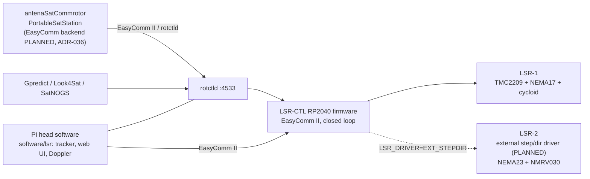
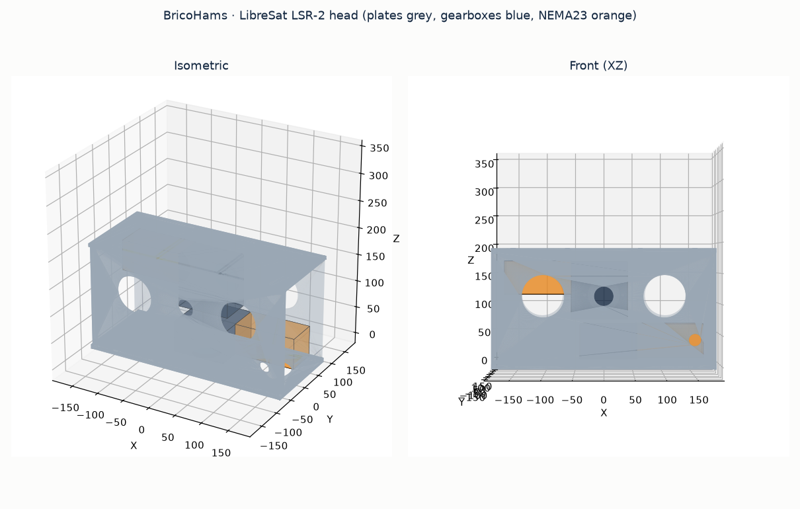

# BricoHams · LibreSat: rotor family architecture

**BricoHams · LibreSat**. Authors: Anatol EA5KAO, Diego EA5JEF, Pedro Roca Molina. Site: <https://bricohams.org>

## 1. Family overview

| | LSR-1 (exists) | LSR-2 (heavy station, in design) |
|---|---|---|
| Use | portable, photo/survey tripod | fixed mast, 40–60 mm |
| Drive | printed cycloid 25:1 + NEMA17 | NMRV030 worm 80:1 + NEMA23 |
| Range | AZ 0–450° (cable wrap), EL 0–180° (flip) | Mk5-class: AZ ±360°, EL −30…150° (PLANNED; no flip, out of scope) |
| Sensing | absolute EL (accelerometer), AZ index + saved position, AS5600 closed loop | absolute magnetic encoder on each **output** shaft (AS5048A/AS5600), index kept as cross-check (PLANNED) |
| Controller | LSR-CTL, internal TMC2209 | LSR-CTL, step/dir to external drivers DM542 or TMC5160 (PLANNED) |
| Structure | printed PETG/ASA, metal only for pins, bearings and bolts | CNC 6061-T6/5083 plates (8 mm, top 6 mm) + cast A356 parts |
| Mass | ≈ 2.3 kg (ESTIMATE, rotator + controller) | head 5.81 kg without bought parts (ESTIMATE) |
| Cost | ≈ 150 € parts (Pi Zero 2 W) | ≈ 205 € material + cutting + foundry (ESTIMATE, VERIFY) |
| Payload | light Yagi / SpaceQuad class | crossed Yagi pair 145/435 on NMRV030; larger dishes need NMRV040/050 or a slewing drive ([LSR2_SIZING](LSR2_SIZING.md)) |

## 2. Shared stack

One firmware, one protocol and one head software drive both rotators.



- **LSR-CTL RP2040 firmware** (C/C++, Pico SDK). LSR-2 adds an external step/dir driver output, flag `LSR_DRIVER=EXT_STEPDIR` (PLANNED).
- **EasyComm II** is the common protocol (plus LSR extensions).
- **rotctld** on port 4533 serves Hamlib clients.
- **Pi head software** (`software/lsr`): tracker, web UI, Doppler. LSR-2 uses a rotator profile `lsr2` (PLANNED).
- **antenaSatCommrotor PortableSatStation** is a client of either rotator. Its EasyComm backend is PLANNED (see its ADR-036).

## 3. LSR-2 mechanical architecture



Geometry is generated by our own scripts (`cad/lsr2/plates.py`, parameters in `cad/lsr2/params.py`).

**Head frame (mm).** The AZ axis is Z through the origin. The top face of the base plate is at z = 0. The EL axis runs along Y at x = 0 and z = EL_Z. The head is 370 mm long along X. The AZ motor points +X and the EL motor −X, which balances the head.

| Plate | Size / t (mm) | Role |
|---|---|---|
| `base` | 370 × 156, 8 | AZ gearbox through `spacer`; PCD 110 holes for the cast AZ housing (phase 3) |
| `spacer` | 80 × 80, 8 | lifts the AZ gearbox so the NEMA23 clears the base |
| `spacer_el` | 80 × 80, 8 | between the EL gearbox output face and `side_a` (NEMA23 is wider than the gearbox) |
| `side_a` | 370 × 185, 8 | EL gearbox output face on the inside |
| `side_b` | 370 × 185, 8 | Ø32 H7 bore for the 6201-2RS, M20 cable gland |
| `top` | 370 × 156, 6 | closes the frame, 8 × M6 into the side plate edges |

Plates are joined by M6 screws into tapped edges. Lightening holes are in all plates except `top` and `spacer`.

**AZ load path.** An external pair of 6206 bearings (120 mm apart) plus a 51206 thrust bearing, in the cast housing, carry the overturning moment. The NMRV030 gearbox carries only **torque** through the keyed shaft. The sizing shows the gearbox output bearings alone allow 38 N·m, below the survival overturning moment of every listed payload (60 N·m for a crossed Yagi pair).

**EL shaft.** The EL gearbox is mounted on `side_a` through `spacer_el`. The 6201 bearing sits in `side_b` and supports the other end of the shaft. The EL axis is 300 mm above the upper AZ bearing in the sizing.

## 4. Design goal: light and cheap

Numbers from [LSR2_MATERIALS](LSR2_MATERIALS.md) (generated by `calc/lsr2_materials.py`; prices and yield are generic, VERIFY):

| Item | Value |
|---|---|
| Plate mass, finished | 4.55 kg (8 mm plates, 6 mm top, lightened) |
| Plate stock bought | 18.90 kg (1 × 6 mm and 1 × 8 mm sheet, 1000 × 500 mm) |
| Waste | 76 % |
| Plates cost | stock 170 EUR + cutting 12 EUR = 182 EUR |
| Cast parts (ESTIMATE) | az_housing 1059 g, el_hub 376 g, 23.2 EUR |
| Finished head | 5.81 kg (without bought parts) |
| Total | 205 EUR, 21.51 kg aluminium bought, 27 % finished/bought |

Buying cut-to-size blanks instead of full sheets cuts the 76 % waste and the cost.

## 5. Fabrication route

1. **PLA 1:1 prototype** of all plates (1.16 kg PLA) for a fit test (or MDF from the DXF). STL in `stl/lsr2/`.
2. **CNC plates** in 6061-T6 or 5083, 8–10 mm: DXF and STEP in `cnc/lsr2/`.
3. **Sand-cast A356** parts, then machined (phase 3, ESTIMATE): AZ bearing housing and EL hub. Patterns are scaled for shrinkage (1.013), drafted and have a 2.5 mm machining allowance.

## 6. Build

```bash
make lsr2     # plates self-test, then freecadcmd: DXF/STEP/STL per plate, assembly STEP, build/lsr2_build_report.json
```

**Windows note.** If Controlled Folder Access blocks `freecadcmd` writing in Documents, set `LSR2_OUT` to a writable folder and copy `cnc/`, `stl/` and `build/` back.

## 7. Status and phases

| Phase | Content | Status |
|---|---|---|
| 1 | Spec, sizing calc, parameter file | done |
| 2 | CNC plates: scripts, DXF, STEP, interference check | done for plates (printed/MDF fit test pending) |
| 3 | Cast parts and patterns | pending |
| 4 | Firmware `EXT_STEPDIR`, LSR-CTL header, `lsr2` profile | pending |
| 5 | `antenaSatCommrotor` EasyComm backend, BOM, assembly docs, branding | pending |

**VERIFY before cutting metal:**
- NMRV030 dimensions: measure the real gearbox with a caliper and update `params.py`, then fit-test the 1:1 print;
- prices, yield and sheet size in the materials budget (local quotes);
- gearbox catalogue ratings with the supplier.

## 8. Credits

The architecture is inspired by the SARCNET SARCTrac Mk5. No SARCNET file or geometry was used: their files carry no licence. See [DESIGN_ANALYSIS](DESIGN_ANALYSIS.md) §5 and the [spec](superpowers/specs/2026-11-16-lsr2-heavy-rotator-design.md).
