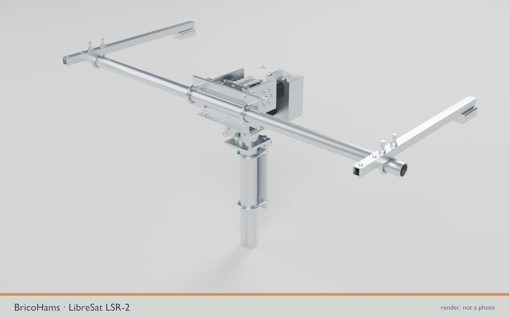

# Automatic calibration and pointing correction (Phase 8)

Applies to LSR-1 and LSR-2. Every step works alone, writes its result to the config file (`~/.config/lsr/config.yaml`, key `calibration`) with a validity flag, and falls back to safe defaults (zero correction) when a step was never run or its result looks wrong (NaN, out of range). Ideas (calibration order, Sun as the reference, correction terms, index and backlash routines, closed loop on the output) come from the SARCNET MK1 derivatives and Rotator7 ([notes](reference/SARCNET_ROTATOR_REPOS.md)); the code is our own.

## Procedure



*Render, not a photo: the LSR-2 Mk4 head with the cover lifted. The AZ index disc sits inside the pillar and the photo-interrupters are described in [ELECTRONICS](ELECTRONICS.md); the EL disc position is an open decision.*

| # | Step | Command | Needs | Result |
|---|---|---|---|---|
| 1 | Level | `lsr calibrate level` | base IMU at rest (hands off, no wind) | mount tilt (pitch, roll) and `level ok` if the tilt is under 0.5° (`calibration.level_threshold_deg`). The tilt is kept as the two tilt terms of the pointing model, so a slightly unlevel tripod costs nothing. |
| 2 | GPS fix | web UI shows "(GPS)" | 1–2 min outdoors | position and UTC for the Sun and the declination. Without a fix the station in the config is used and the result says `position_source: config`. |
| 3 | Compass | `lsr calibrate compass [--ellipsoid]` | a magnetometer (`calibration.magnetometer.enabled: true`) | true-north offset = tilt-compensated magnetic heading (low-pass α 0.02, hard-iron min/max, optional soft-iron fit) + declination from the WMM. **The MPU-6050 has no magnetometer: without one the step reports `skipped` and you use the Sun.** Declination: `lsr/data/WMM2025.COF` when installed, else `calibration.declination`, else 0 (flagged). |
| 4 | Sun | `lsr calibrate sun` (sensor) or `lsr calibrate sun-manual` (pinhole sight) | Sun above 5° | AZ and EL offset. Most accurate step; no magnetometer needed. |
| 5 | Index and backlash | `lsr calibrate index` | index sensor (LSR-2) or output encoders | homes on the index, then approaches it from both directions: backlash per axis. |
| 6 | Pointing fit | `lsr pointing fit points.csv --save --enable` | 12+ points over the sky | all correction terms, residual RMS. |
| 7 | Acceptance | status table in the web UI | | residual RMS **< 0.1°** (the SARCTrac Mk5 class of accuracy). |

`lsr calibrate all` runs level, compass, Sun (if a sensor command is configured) and index in this order. Add `--sim` to rehearse against the built-in simulator.

### Sun with a sensor

Set `calibration.sun_sensor.command` to a program that prints one number: a photodiode on an ADC, or the noise power of your SDR on a dish (for example a small `rtl_power` wrapper). The rotator moves a raster around the predicted Sun (default 6° span, 1.5° steps), then a finer second pass. The peak of a log-paraboloid fit gives the offsets. The Sun's motion during the scan (0.25°/min) is compensated. Do it in clear sky; a weak peak reports `repeat in clear sky`.

### Sun by hand (no sensor)

Jog until the Sun's spot sits on the cross-hair of the printed pinhole or shadow sight, then run `lsr calibrate sun-manual` (or press **Antenna is on the Sun** in the web UI). Every Sun mark is appended to `calibration.points_file` for the pointing fit.

### Index and backlash

LSR-2: the firmware seeks the photo-interrupter on both axes and measures the backlash itself (`XCAL BACKLASH`, stored in flash; the firmware compensates it, the head does not repeat it). LSR-1 (no index slot): the head approaches the same angle from both sides and compares the output-encoder readings (encoder versus step count); the result goes to `pointing.backlash_az/el` and is compensated by direction. Anything over 2° is rejected as a mechanical fault.

### Pointing fit

`points.csv`: `sky_az,sky_el,mount_az,mount_el[,weight[,note]]` (true geometric sky position, and what the rotator read). Sources: Sun marks (automatic), known landmarks, satellite beacon peaks (peak of the signal against the predicted position). With few points only the first terms are fitted (`--terms az_off,el_off,tilt_n,tilt_e` to choose). The output lists the RMS before and after, each term, and PASS/FAIL against 0.1°. With `--save` the parameters go to `pointing.params`; `--enable` also switches the correction on if the RMS is below 0.1°.

Model terms: AZ offset (north), EL offset (horizon), mount tilt north/east (from step 1), EL-axis non-perpendicularity, collimation (boresight) error, azimuth encoder eccentricity (sin/cos), optional atmospheric refraction (`pointing.refraction`), and per-axis direction-dependent backlash. Commanded: sky → mount. Reported: mount → sky.

### Enabling

```yaml
pointing: {enabled: true}      # apply the model to every commanded and reported position
control:  {enabled: true}      # closed loop, step-loss and stall supervision, safe states
```

Both default to off, which keeps the previous behaviour exactly.

## Closed loop and safe states (`control:`)

| Feature | Setting | Default |
|---|---|---|
| Deadband: commands that change the target less than this are not sent | `deadband` | 0.1° LSR-1, 0.05° LSR-2 |
| Step loss: step count and output encoder differ by more than `step_loss_deg` for `step_loss_s` → re-sync the step count to the encoder, log it | `step_loss_deg`, `step_loss_s` | 0.5°, 1 s |
| Stall: commanded speed but the encoder does not follow for `stall_s` → stop, latch a fault | `stall_s`, `stall_min_dps` | 0.8 s, 0.5°/s |
| Encoder trim: after a move, the remaining encoder error (up to `max_trim_deg`) is corrected once | `trim` | on |
| Velocity feed-forward for `set_pos` callers (rotctld, Gpredict); the lsr tracker already leads with `tracking.lead_s` | `feedforward` | off |
| Soft limits per model (from `limits`) | `soft_margin` | 0° |
| Faults from the GPS, the boom IMU, the encoders | `require_gps`, `require_imu`, `require_encoders` | off |
| Reaction to a fault | `on_fault: stop` or `park` | stop |

Faults latch and commands are ignored until you clear them (`POST /api/control/clear`). Status is in the web UI (Setup → Calibration), in `GET /api/calibration`, in the `control` field of `/api/status`, and in rotctld `\dump_state` (`lsr_state=`, `lsr_faults=`, only when `control` or `pointing` is enabled). Cable anti-windup and shortest path are the Phase 6c planner (`limits.anti_windup`); this phase does not duplicate them.

## Magnetic declination

`software/lsr/data/WMM2025.COF` is **not shipped yet**: it is the official NOAA WMM2025 table and must be copied unmodified from <https://www.ncei.noaa.gov/products/world-magnetic-model> (the placeholder file next to it says so). Until then the declination comes from `calibration.declination` or is 0, and the NOAA reference test is skipped. The model code (`lsr/geomag.py`) is complete and tested with a synthetic dipole.

## Field checklist

1. Level (≤ 0.5°) → 2. GPS "(GPS)" → 3. compass only if a magnetometer is fitted → 4. Sun (sensor or manual) → 5. index/backlash → 6. take 12+ marks across the sky, fit, check RMS < 0.1° → 7. enable `pointing` and `control`.
