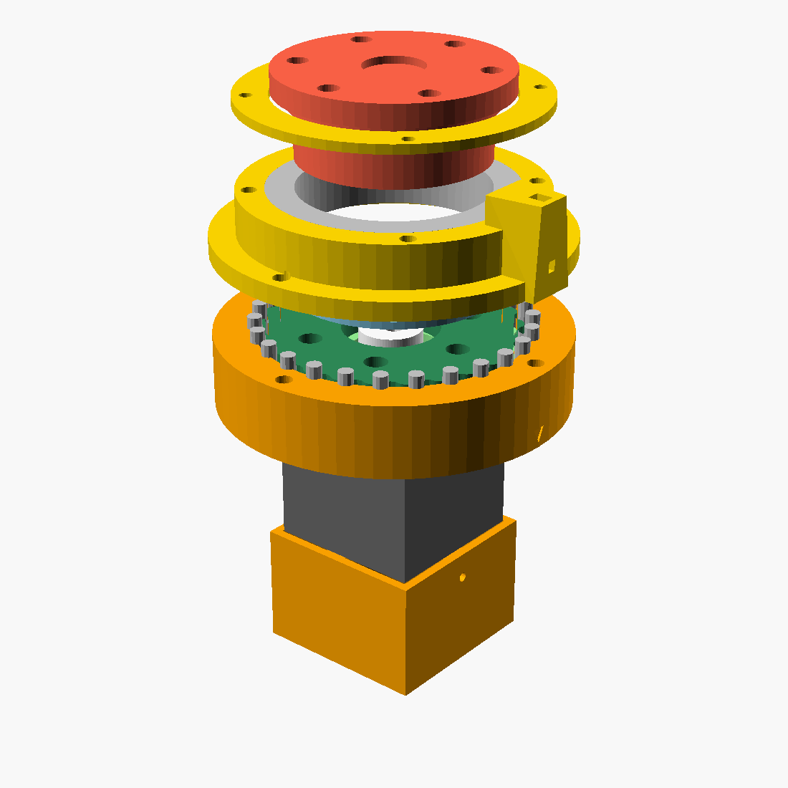

# Design analysis: SatNOGS Rotator v3, AntRunner, Sweep Dynamics → LSR-1

This document lists what each reference design does, what limits it for **portable** satellite work, and the decision taken in LSR-1. Data comes from each project's own documentation (links at the end).

## 1. SatNOGS Rotator v3 (Libre Space Foundation)

| Aspect | v3 design |
|---|---|
| Drive | Worm gear reduction **30:1** (axes at 90°), driven from the motor by a **GT2 belt** (16–40 T pulleys) |
| Motors | 2 × NEMA17 steppers (or DC motors); stall torque 0.4–1.5 Nm, 100–200 rpm |
| Structure | 20 × 20 aluminium T-slot frame, 15 printed parts (mainly ABS), 38 non-printed parts |
| Sensing | Rotary encoders and end-stop switches |
| Controller | SatNOGS Rotator Controller board (alternatives: Arduino Uno + CNC shield, RAMPS 1.4); Easycomm II protocol through Hamlib |
| Figures | ≈ 5 kg, 280 × 140 × 140 mm, ≈ 30 Nm, ≈ 5°/s, 300–400 USD |
| Known issues (wiki) | End-stop parts can collide; the worm gear needs lapping to run smoothly; motor bolt compatibility (specific M4 hardware) |

**Strengths:** a self-locking worm, a lot of torque, and a mature Easycomm controller that SatNOGS stations use around the world.

**For portable use:**
- The extrusion frame and two belt stages make it heavy (5 kg) and bulky.
- A printed worm wears and has to be lapped, and its backlash grows with use.
- There is no elevation flip: elevation is 0–90°.
- It needs a PC with Gpredict next to it.

## 2. AntRunner (MuseLab)

| Aspect | Design |
|---|---|
| Electronics | **ESP32 running Grbl_Esp32**; serial (USB) or Wi-Fi (AP `GRBL_ESP`, telnet, web UI) |
| Protocol | G-code; Hamlib driver **grbltrk (model 2401)** maps 360° to 40 mm (`G0 X.. Y..`); Look4Sat through an extra ESP32-C3 bridge |
| Mechanics | Acrylic plates (5 / 10 mm), U bracket for the antenna |
| Figures | AZ 0–360°, EL 0–180°, load up to 5 kg, backlash 1°, **3 kg**, Ø120 × 65 mm |
| Power | 12 V battery or power bank with a 12 V PD trigger cable |
| Setup | North and level by hand with a phone compass before power-up (open loop, no reference) |

**Strengths:** compact and portable, it already uses PD power banks, and a phone can control it (Look4Sat).

**Weaknesses:**
- It is open loop with no reference. North and level are set by eye with a magnetic phone compass, which is easily 5–10° off near metal.
- A lost step is never detected.
- GRBL is a CNC interpreter that needs a special Hamlib backend.
- Wi-Fi control still needs an external computer or phone app doing the tracking.
- Acrylic is brittle in cold weather and in transport.

## 3. Sweep Dynamics (design inspiration for the printed parts)

Sweep Dynamics shows an **ultra-compact 3D-printed 20:1 cycloidal drive** with "minimal backlash, high torque", which even works with a 23 mm "pancake" NEMA17.

What we take from it:
- the cycloid as the printed reduction, instead of worms or printed planetary gears;
- the motor directly behind the reducer, in one cylindrical "actuator" module.

A cycloid suits printing because:
- many teeth share the load (about half the ring pins at any time), so contact stresses stay low;
- backlash depends on the pin clearance, not on a gear mesh;
- the ring teeth are **steel dowel pins**, so the printed parts only carry low surface pressure.

## 4. Decisions in LSR-1

| Problem in the references | LSR-1 decision | Where |
|---|---|---|
| Heavy frame, belts and worms (SatNOGS) | Two **identical printed cycloid actuators** (25:1, Ø94 mm, ~0.6 kg each with the motor) bolted directly: base → AZ actuator → head → EL actuator → stub | `cad/lsr.scad` |
| Printed teeth wear | Ring teeth are **52 hardened 4 × 20 mm dowels**; output pins are 4 × 30 mm dowels; the discs run on 6803 bearings; the output runs on **2 × 61810** thin-section bearings | [MECHANICAL](MECHANICAL.md) |
| Meshing has to be right first time | Profile generated from the standard cycloid equations; `calc/cycloid_check.py` sweeps a full cycle: minimum running clearance 0.13 mm, envelope 0.55 mm inside the bore | `calc/` |
| Open loop, no reference (AntRunner) | **AS5600 on each motor's rear shaft** (closed loop: lost steps are detected and corrected); **elevation absolute** from an MPU-6050 on the stub; azimuth from the flash-saved position checked by the encoder, or a **hall index** (`HOME`) | [FIRMWARE](FIRMWARE.md) |
| North by magnetic compass | **Sun alignment**: printed pinhole sun sight on the boom; one button sets the true azimuth (Sun position accurate to 0.03°); base-level IMU for the tripod | [FIELD_GUIDE](FIELD_GUIDE.md) |
| Overhead passes too fast in azimuth; 0–360° cable limit | **Pass planner**: normal, flip (EL 0–180°) and cable-wrap (AZ 0–450°) candidates, azimuth rate-limited, pointing error checked | `software/lsr/passes.py`, [SIZING](SIZING.md) |
| Needs an external PC (both) | **Raspberry Pi Zero 2 W on the controller board**: Wi-Fi AP, phone web UI, offline TLEs, GPS position and clock, onboard tracking; Gpredict/Look4Sat/SatNOGS still work through `rotctld` :4533 | [SOFTWARE](SOFTWARE.md) |
| Special protocol (GRBL) | Firmware speaks **Easycomm II** (Hamlib 202/204, SatNOGS) plus LSR extensions (`XP` absolute, `XS` status, `XCAL` …) | [FIRMWARE](FIRMWARE.md) |
| No radio control | **Yaesu FTX-1 CAT** Doppler (MAIN RX / SUB TX, no hardware split), any Hamlib radio, **OpenGD77** clock sync and keps upload | [SOFTWARE](SOFTWARE.md) |
| Power: 12 V only | 9–24 V input, XT30 and DC jack, reverse-polarity FET, TVS, PTC; USB-C PD at 12/15/20 V works directly | [POWER](POWER.md) |
| Acrylic / extrusion | PETG/ASA prints, metal only where it carries load (pins, bearings, bolts, stub tube) | |
| Tripod | Interchangeable adapters: 3/8″ (and 1/4″ with a reducer) photo, **5/8″ survey**, 35 mm speaker stand, 25/32/40 mm mast | `stl/tripod/` |

## 5. Mechanical layout



```
           antenna boom (SpaceQuad / Arrow class, clamped at its CG)
                 │
   EL actuator ──┤ stub Ø20 (aluminium or fiberglass), boom clamp, sun sight, boom IMU
   on the tower  │
   head (turntable + tower, one print)
   AZ actuator (motor down, hall tab on the front housing)
   base (motor + encoder inside, e-box shelf on the side)
   tripod adapter (3/8″, 5/8″, 35 mm spigot, mast)
```

- **Elevation is cantilevered:** the antenna sits about 200 mm to the side of the azimuth axis. The boom can swing through vertical (flip) without hitting the base or the tripod.
- **The elevation output bearings take the bending.** The cantilever moment is about 2 Nm with 1 kg of antenna, and two 61810 bearings have a static rating of about 6 kN each.

## 6. Accepted trade-offs

- **A cycloid is not self-locking.** The motors hold at 35 % current: about 1.5 Nm at the output, or 4 Nm at full current. Unpowered, a strong wind can back-drive the elevation, so lower the boom (park at elevation 90° pointing up, or 0°) before switching off in wind.
- **Printed tolerances.** The meshing clearance (0.15 mm design) depends on the printer. `PROFILE_CLR` in `lsr_params.scad` adjusts it. Backlash at the output should measure about 0.2–0.5°; [TESTING](TESTING.md) T-M3 checks it.
- **The cantilevered elevation stub** puts a small tipping moment on the tripod. Hang the battery from the tripod hook.

## 7. SARCTrac Mk5 (SARCNET) -> LSR-2

LSR-2 is our own redesign of the architecture SARCNET published for the SARCTrac Mk5 (2 × NMRV030 80:1 + NEMA23, 51206 thrust bearing, 10 mm aluminium saddle plates, Pico-class MicroPython controller). The Mk5 FreeCAD files carry no licence, only an "as-is, no warranty" note. We used them only as a local reference to read the architecture: no file, geometry or drawing is copied, and all LSR-2 geometry comes from our own scripts. Full details in the [LSR-2 spec](superpowers/specs/2026-11-16-lsr2-heavy-rotator-design.md).

| Mk5 weak point | LSR-2 decision |
|---|---|
| A single index slot, open loop between indexes | AS5600 closed loop on each axis (same as LSR-1) plus a photo-interrupter index per axis |
| Thrust bearing housed in PVC pipe with silicone | Bearing seat machined in the **aluminium body** (cast A356 or CNC), V-ring/lip seal and drain hole |
| Threaded rod used as shaft, roll-pin keys | Ø14 h7 stainless 1.4404 shaft with an A5×5 DIN 6885 key, matching the NMRV030 bore |
| Galvanised angle iron (corrosion, mixed metals) | Body, yoke, saddle and clamps in A356-T6 or 6082/6061; A2/A4 fasteners with Tef-Gel or Duralac at Al–steel joints |
| MicroPython on a separate board | **LSR-CTL RP2040 firmware** has a step/dir output for external drivers (DM542 or TMC5160); EasyComm II and rotctld unchanged |
| 48 V only | 24–48 V input; 5 V and 3.3 V rails stay on the board |
| No wind or torque budget published | `calc/lsr2_sizing.py` gives wind moment, worm self-locking, bearing life and the safe payload limit ([LSR2_SIZING](LSR2_SIZING.md)) |

Credit: the architecture idea comes from SARCNET. No SARCNET file was used or derived.

## Sources

- SatNOGS Rotator v3: [wiki.satnogs.org/SatNOGS_Rotator_v3](https://wiki.satnogs.org/SatNOGS_Rotator_v3), [GitLab satnogs-rotator](https://gitlab.com/librespacefoundation/satnogs/satnogs-rotator)
- AntRunner: [github.com/wuxx/AntRunner](https://github.com/wuxx/AntRunner) (README, schematic `AntRunner-v1.0.pdf`), Hamlib grbltrk driver
- Sweep Dynamics: [sweepdynamics.com](https://www.sweepdynamics.com/) (20:1 printed cycloidal drive demonstrations)
- OK1HRA, [Parameterizable 3D-print antenna rotator in OpenSCAD](https://github.com/ok1hra/Parameterizable-3D-print-Antenna-rotator-in-OpenScad) (another reference)
- BigSignal SpaceQuad: [bigsignal.es](https://www.bigsignal.es/en/antennas/big-signal-spacequad-116.html). The figures used here (≈ 1 kg, ≈ 0.1 m² wind area) are an envelope; weigh and measure your own antenna and re-run `calc/sizing.py`.
