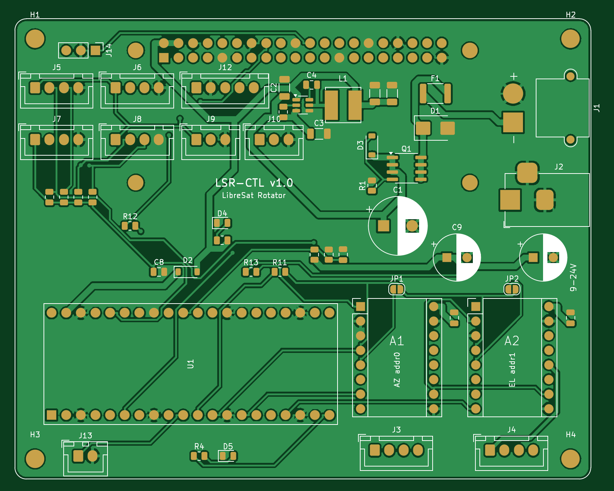

# Electronics: LSR-CTL v1.0 controller board



## Overview

The board is 100 × 80 mm with 2 layers, 1.6 mm FR4 and 1 oz copper, with ground pours on both sides. Everything is hand-solderable: 0805, SOD-123, SMB, SOIC-8 and TSOT-23-6 parts, plus plug-in modules.

| Block | Parts | Notes |
|---|---|---|
| Input 9–24 V | J1 XT30 (male), J2 5.5 × 2.1 jack, F1 PTC 2.5 A, D1 SMBJ24A TVS, Q1 AO4407A P-MOSFET reverse protection (gate clamp D3 12 V, R1 10 k), C1 470 µF bulk | Inputs are paralleled; use one at a time. The protected rail is **VM**. |
| 5 V / 2 A | U2 **AP63205WU** buck (fixed 5 V), L1 6.8 µH (SRN6045TA), C2/C3 10 µF 50 V, C5/C6 22 µF, C4 boot, R2 enable | Feeds the Pi Zero 2 W (header pins 2/4) and the Pico VSYS through D2. |
| MCU | U1 **Raspberry Pi Pico** (Pico W / Pico 2 also fit) on headers | USB stays usable; D2 isolates VSYS. |
| Motor drivers | A1/A2 **TMC2209 StepStick** (UART, addresses 0 and 1 set by MS1), C9/C10 100 µF at VM, C11/C12 100 nF | Single-wire UART: GP8 → 1 kΩ → PDN_UART ← GP9. |
| Sensors | J5/J6 on I²C0 (AZ encoder, base IMU), J7/J8 on I²C1 (EL encoder, boom IMU), 4.7 kΩ pull-ups R7–R10, J9/J10 hall inputs, J12 GPS (UART1 + PPS) | All 3.3 V from the Pico regulator. |
| Pi link | J11 2×20 socket on the **bottom side**; UART0 ↔ Pi GPIO14/15; Pi GPIO23 → RUN (R12); J14 SWD header wired to Pi GPIO24/25 | The Pi can reset and re-flash the Pico (`flash_pico_from_pi.sh`). |
| User I/O | J13 PARK/STOP button, D4 power LED, D5 status LED (GP15), voltage divider R5/R6 (÷11) on GP26 | |

The netlist **is** the schematic: `hardware/gen_pcb.py` (the `PICO`, `PIHDR`, `PARTS` tables) and the generated `hardware/fab/lsr_ctl_netlist.md`.

## Pico pin map

| GPIO | Pico pin | Function | | GPIO | Pico pin | Function |
|---|---|---|---|---|---|---|
| GP0 | 1 | UART0 TX → Pi RXD (GPIO15) | | GP13 | 17 | DIR EL |
| GP1 | 2 | UART0 RX ← Pi TXD (GPIO14) | | GP14 | 19 | /EN both drivers (10 k pull-up) |
| GP4 | 6 | UART1 TX → GPS RX | | GP15 | 20 | status LED |
| GP5 | 7 | UART1 RX ← GPS TX | | GP16/17 | 21/22 | I²C0 SDA/SCL (AZ side) |
| GP6 | 9 | GPS PPS | | GP18/19 | 24/25 | I²C1 SDA/SCL (EL side) |
| GP7 | 10 | PARK/STOP button | | GP20 | 26 | hall AZ index |
| GP8 | 11 | TMC UART TX (via 1 k) | | GP21 | 27 | hall/limit EL (optional) |
| GP9 | 12 | TMC UART RX | | GP26 | 31 | ADC0 VM sense (÷11) |
| GP10/11 | 14/15 | STEP/DIR AZ | | VSYS | 39 | 5 V through D2 |
| GP12 | 16 | STEP EL | | 3V3 | 36 | sensors, driver logic |

## Connectors (JST-XH 2.5 mm)

| Ref | Pins (1 → n) | Goes to |
|---|---|---|
| J3 / J4 | 1A, 1B, 2A, 2B | AZ / EL motor. One coil on 1A/1B, the other on 2A/2B. If an axis turns the wrong way, use `XC dir_az=-1` instead of rewiring. |
| J5 / J7 | 3V3, SDA, SCL, GND | AS5600 AZ / EL |
| J6 / J8 | 3V3, SDA, SCL, GND | MPU-6050 base (in the e-box) / boom (on the stub socket) |
| J9 / J10 | 3V3, SIG, GND | 3.3 V hall switch (DRV5032FB / AH1806, open drain, internal pull-up) |
| J12 | 3V3, GND, RX (to GPS), TX (from GPS), PPS | ATGM336H / NEO-M8N at 9600 baud |
| J13 | BTN, GND | Short press: stop. 2 s press: park. |
| J14 (2.54) | SWCLK, GND, SWDIO | Short jumper wires to the Pico's SWD pads (debug end) |

**EL harness.** One CAT5e cable carries both I²C1 devices: the EL encoder at the motor rear and the boom IMU on the stub socket. Use these pairs:
- orange: SDA + GND;
- green: SCL + GND;
- blue: 3V3 + GND.

At the head, split it with a 4-way JST-XH Y. I²C1 runs at 100 kHz for this length (about 1.5 m).

## Assembly order

1. SMD parts first: U2, then L1, C2–C6, D1–D3, F1, Q1, the resistors, C7/C8/C11/C12 and the LEDs.
2. **Test the supply before fitting any module.**
   - Apply 12 V on J2 from a current-limited supply set to 200 mA.
   - Check VM ≈ 12 V and 5 V on C5.
   - Reverse the polarity briefly: VM must stay at 0 V.
3. THT parts:
   - J1–J14, C1, C9, C10;
   - the 2 × 1×20 headers for the Pico;
   - 4 × 1×8 female headers for the StepSticks;
   - the 2×20 socket J11 on the **bottom** side, soldered from the top.
4. Solder jumpers JP1/JP2: leave them **open** unless your TMC2209 module needs its pin 5 (PDN) on the UART line. See VERIFY 1.
5. Plug in the Pico and flash it (see [FIRMWARE](FIRMWARE.md)). `XS` should answer over USB.
6. Plug in the TMC2209 modules **with the power off**.
   - Set the Vref potentiometer to mid-range. It is ignored in UART mode but used as the fallback current.
   - `XT` must report `ok=1` for both drivers, and `XS` must show `tmc=1,1`.
7. Fit the Pi Zero 2 WH under the board (11 mm M2.5 standoffs).

## VERIFY before ordering or powering

1. **TMC2209 module pinout.** The footprint assumes the common BTT/FYSETC StepStick layout:
   - left row: EN, MS1, MS2, PDN_UART, (PDN/NC), CLK, STEP, DIR;
   - right row: VM, GND, 2B, 2A, 1A, 1B, VIO, GND.
   Some clones put UART on pin 5: close JP1/JP2 and check `XT`.
2. **AP63205WU pinout (TSOT-23-6):** 1 FB, 2 EN, 3 VIN, 4 GND, 5 SW, 6 BST. Check the datasheet revision you buy. The pin-compatible AP63203 gives 3.3 V: do not swap them.
3. **Inductor:** 6.8 µH with Isat ≥ 3 A, 6 × 6 mm (Bourns SRN6045TA-6R8M or similar).
4. **Input voltage:** the TVS starts conducting at about 26.7 V. The TMC2209 limit is 29 V and the AP63205 limit 32 V. Do not exceed 24 V nominal, and do not use 28 V USB-PD profiles.

## LSR-2 external drivers

LSR-2 uses the same LSR-CTL board with the TMC2209 modules left out, and two external step/dir drivers (one DM542 per axis, or a TMC5160 in step/dir mode). Build with `make lsr2` and pin table: see [FIRMWARE](FIRMWARE.md#lsr-2-external-drivers).

- **DM542 inputs (3.3 V → 5 V level converter):** PUL+, DIR+ and ENA+ go to the 5 V rail (XL7015 output); PUL−, DIR− and ENA− are driven from the Pico (GP10/GP11/GP2 for AZ, GP12/GP13/GP3 for EL) through a 3.3 V → 5 V level converter / buffer (4-channel module, or 74HCT245 / ULN2003-style stage that pulls the − pin to GND; the logic is then inverted: set `EXT_STEP_ACTIVE`, `EXT_DIR_POS_LEVEL` and `EXT_EN_ACTIVE` to match). The SARCTrac Mk5 (SARCNET) uses a 3.3 → 5 V converter for the same reason: the DM542 opto LED needs about 7–16 mA at 5 V, which a 3.3 V Pico pin cannot supply reliably. VERIFY with the datasheet of your DM542.
- **Isolation:** keep the opto ground separate. The motor supply never connects to the logic ground.
- **Motor supply:** one 48 V DC supply per rotator, fused, to both DM542 VCC/GND (default 48 V 6 A; the Mk5 uses a Mean Well S-400-48, see [ARCHITECTURE](ARCHITECTURE.md) §7b), with a **2200 µF 63 V** bulk capacitor on the 48 V rail (also the hold-up for the power-loss save below, VERIFY on the bench). Logic: an **XL7015** buck module (48 V → 5 V) feeds the Pico/Pi 5 V rail and the DM542 opto 5 V (the Mk5 does the same). LSR-CTL keeps its own 12–24 V input for its own rails if you prefer to power the logic separately (the TVS limit in the VERIFY list above applies to that input). Use Tef-Gel on screw terminals exposed to weather.
- **48 V power-loss detect:** an opto-isolated sense from the 48 V rail (PC817 LED through about 47 kΩ / 2 W in series with a 1N4007 reverse-protection diode, VERIFY the resistor for 2–3 mA) pulls **GP22 (`PIN_PWRFAIL`)** low while 48 V is present (internal pull-up). When 48 V disappears the pin goes high; the firmware debounces 5 ms, stops the motors, switches the drivers off and **saves the position to flash** (error `E_PWR`, bit 64). It is armed only after 48 V has been seen once, so a bench run on USB power does not trigger it. Same concept as the Mk5 (SARCNET).
- **DM542 DIP switches, NEMA23 57BYG250H-8 (2.8 N·m, 3 A), 400 microsteps/rev** (VERIFY against the table printed on your driver): peak current 3.0 A (SW1–SW3 per the table; the DM542 peak is about 1.4 × RMS, so check you are not at 3 A RMS), SW4 standstill current at half (on), SW5–SW8 = **400 pulses/rev** (2 microsteps × 200 steps; the Mk5 setting). 12°/s on the 80:1 gearbox = 1066.7 steps/s per axis.
- **Cable:** shielded motor cable, shield to the driver ground at one end only.
- **Alternative controller (Mk5):** SARCTrac Mk5 uses an Elecrow **Pico W5** board with a Wi-Fi access point and Telnet instead of a USB/UART link. LSR-2 keeps the LSR-CTL RP2040 board (opto stage, connectors, Pi link); a Pico W on the same header can offer Wi-Fi with the same EasyComm II command set, but this is not built or tested here.
- **Serial default:** EasyComm II at **9600 8N1** on the Pi link (UART0) for LSR-2 (115200 stays on LSR-1); USB CDC ignores the baud rate. See [FIRMWARE](FIRMWARE.md).

## Sensors

- **AS5600:** diametric 6 × 2.5 mm magnet on the motor rear shaft, 1–2 mm air gap. `XS enc=1` confirms the magnet is detected (status bit MD).
- **MPU-6050 boom IMU:** board X along the stub. Calibrate with `XCAL EL=0` on a level boom, then `XCAL ELIMU`. Change `imu_el_dir` if the elevation reads with the wrong sign.
- **MPU-6050 base IMU:** stuck flat in the e-box. It reports tripod tilt; zero it with `XCAL LEVEL` on a surface you know is level.
- **Photo-interrupter index (LSR-2):** one slotted photo-interrupter per axis (EE-SX1103 class, 5 mm gap, NPN open collector; the idea is from the SARCTrac Mk5, SARCNET) reading a printed ASA notch disc (AZ on the collar, EL on the boom_socket hub). Wire to J9 (AZ, GP20) and J10 (EL, GP21): 3V3, SIG, GND. The pin has the internal pull-up and is low while the notch is in the sensor (`IDX_SLOT_LEVEL 0`). Power the sensor LED from 3V3 through the series resistor of the board (VERIFY for 3.3 V; a 5 V-only sensor would put 5 V on the Pico pin: use the open-collector output only, or a divider). The notch must be at least 4° wide and its edges at least 3° inside the axis limits (the printed discs give about 8–10°). Procedure and the backlash calibration: [LSR2_ASSEMBLY](LSR2_ASSEMBLY.md).
- **Hall index:** a 3.3 V hall switch such as the DRV5032 (omnipolar variant) or AH1806 (LSR-1 only; LSR-2 uses the photo-interrupter on the same pin). **Not the A3144**, whose minimum supply is 4.5 V. The magnet sits under the turntable at radius 45 mm.
- **GPS:** UART at 9600 baud, NMEA RMC and GGA. It gives the position and UTC to the Pi, which needs no internet in the field. The PPS pin is wired for future use.

## Regenerating the board

```bash
sh hardware/build_pcb.sh          # place -> DSN -> Freerouting -> pours -> DRC (about 1 min)
python3 hardware/export_fab.py    # Gerbers, drill, BOM, pos, netlist, PNG previews
```

The committed board in `hardware/pcb/` is fully routed:
- **0 unconnected pads and 0 clearance errors.**
- The remaining DRC items are three cosmetic silkscreen warnings and one library-table note (the project `fp-lib-table` fixes the latter when you open it in KiCad).
- Order with `hardware/fab/lsr_ctl_gerbers.zip`: 2 layers, 1.6 mm, HASL or ENIG, any colour.
