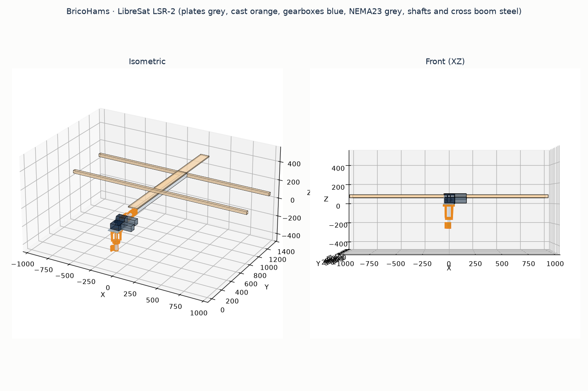
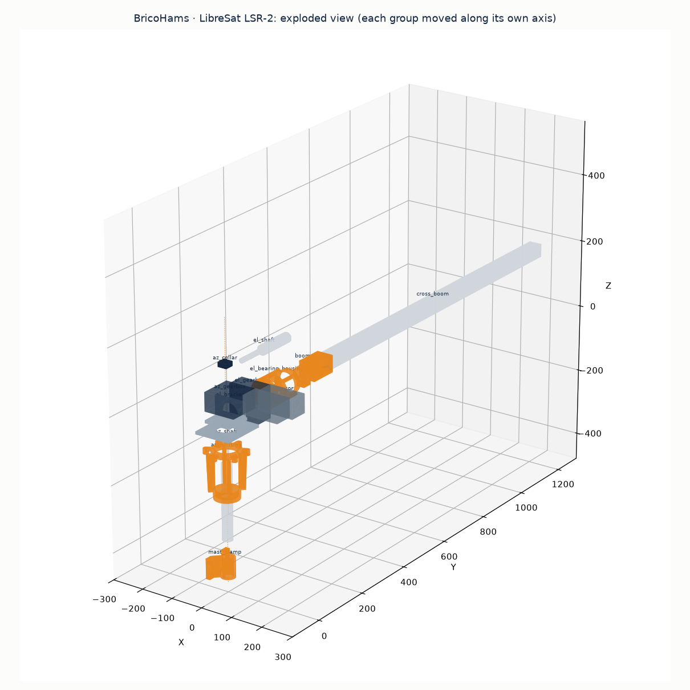

# BricoHams · LibreSat LSR-2: assembly guide

Authors: Anatol EA5KAO, Diego EA5JEF, Pedro Roca Molina.

Parts and prices: [BOM_LSR2](BOM_LSR2.md). Design and checks: [ARCHITECTURE](ARCHITECTURE.md), [LSR2_SIZING](LSR2_SIZING.md), [LSR2_MATERIALS](LSR2_MATERIALS.md). Every torque, fit and catalogue value below is **VERIFY** against your real parts.

Axes: AZ is Z through the origin, the top face of `base` is z = 0, EL runs along Y. Use A4 fasteners and put Tef-Gel on every thread (step 7).

## 0. Measure the real NMRV030 (VERIFY gate)

1. Measure both gearboxes with a caliper: output face, hollow bore (Ø14 H7), key, centre height, flange pitch, motor flange (tool: caliper, 0.02 mm).
2. Edit `NMRV030_GEO` and `GEARBOX` in `cad/lsr2/params.py`, run `make lsr2` (self-tests and the interference check must pass), commit the new STEP/DXF/STL.
3. Do not order metal before this passes.

## 1. Print the PLA 1:1 prototype and fit-test

1. Print the plates from `stl/lsr2/` (PLA, 3 walls, 20 % infill).
2. Check: gearbox and NEMA23 clearance to `base`, `spacer` and `el_bracket` (the motor is 56.4 wide, the gearbox 56); both PCD 65 face patterns; the 6 × Ø6.6 PCD 110 holes; tapped-edge hole positions of `el_bracket` line up with the base plate holes (use M6 screws in the printed holes).
3. Tool: caliper, real gearboxes and bearings. Fix `params.py`, repeat step 0 if anything is off.

## 2. Order the CNC plates

1. Files: `cnc/lsr2/{base,spacer,el_bracket}.dxf` (notes in the DXF text) and `.step`.
2. Material: 6061-T6 or 5083, 8 mm. Order cut-to-size blanks (blank + 10 mm margin): at this size it is cheaper than a full sheet ([LSR2_MATERIALS](LSR2_MATERIALS.md) compares both).
3. Tolerances: general ±0.2 mm; gearbox pilot Ø55.2 and bolt holes ±0.1 mm.
4. Edge taps M6 × 15 deep (bottom edge of `el_bracket`, x = ±20, ±42): drill Ø5 by hand and tap by hand (tap M6, cutting oil), perpendicular to the face.
5. Deburr all edges and holes (file, deburring tool).

## 3. Casting

1. Print the patterns and the core box in PLA from `stl/lsr2/`: `az_housing_pattern`, `az_housing_corebox`/`az_housing_cores`, `mast_clamp_pattern`, `el_bearing_housing_pattern`, `boom_socket_pattern` (STEP in `cast/lsr2/`). Sand and seal the surfaces; the pattern maker adds the 2° draft on prismatic parts and 3 mm fillets.
2. Send to the foundry (A356-T6, shrink 1.013 VERIFY) with the parting notes:
   - `az_housing`: parting z = −8 (flange face), one drag half; core A on the flange face (cope), core B through the lip hole (drag);
   - `mast_clamp`: parting z = −175 (boss top), drag only, bore cast solid;
   - `el_bearing_housing`: parting at the flange face, flange in the cope, rings and ribs in the drag, bores cast solid;
   - `boom_socket`: parting at the mouth face, hub up, the 40.5 square pocket formed by one prismatic core (print at the mouth), Ø30 bore cast solid.
3. Machining list after casting (2.5 mm allowance): `az_housing`: bearing seats Ø62 H7 (6206) and the 51206 seat, flange face, 6 × M6 × 12 taps on PCD 110 (drill Ø5); `mast_clamp`: bore Ø30 H7 and V groove, Ø6 cross-pin hole (reamed through the shaft at step 5), U-bolt ear faces; `el_bearing_housing`: both 6206 seats Ø62 H7 in ONE setup (coaxial, span 62 mm), Ø24 flange bore, boss recess Ø52, flange face, 4 × Ø6.6 holes, DIN 472 circlip grooves; `boom_socket`: bore Ø30 H7 (key 8), pinch slit, pinch screw hole (M6), 2 × Ø9 cross holes for the M8 bolts (drilled together with the tube at assembly), mouth face.
4. Proof-load the first mast clamp before relying on it (step 9).

## 4. Turn the shafts

Material stainless 1.4404, bars Ø33 × 316 (AZ) and Ø33 × 216 (EL). Tool: lathe, gun drill for the AZ bore.

| Shaft | From (mm) | To (mm) | Ø (mm) |
|---|---|---|---|
| az_shaft | −225 | 1 | 30 |
| az_shaft | 1 | 81 | 14 h7 |
| el_shaft | 70 | 162 | 14 h7 (gearbox hub, torque only; 37 mm stub beyond it) |
| el_shaft | 162 | 276 | 30 (two 6206, then the boom_socket hub) |

1. `az_shaft`: hollow, Ø16 bore from the bottom end to z = −1 (the Ø14 step stays solid, VERIFY gun drilling with the machinist); Ø6 radial cable exit at z = −4; Ø30 bearing seats (bearing fit k6-j6, VERIFY); Ø6 cross-pin hole in the bottom Ø30.
2. Keyways: Ø14 top 5 × 5, slot 40 long (AZ); `el_shaft` key 5 × 5 on the Ø14 (inside the hub) and 8 × 7 on the Ø30 end (VERIFY against the socket). Test the key fit with the real keys and gearbox bore (push fit, no rocking).
3. Deburr, polish the seal surfaces for the V-rings, cut the circlip grooves: DIN 471 Ø30 ring under the 51206, and two DIN 471 Ø30 rings either side of the fixed (outer) EL bearing (positions from `params.py`/`cast_parts.py`, VERIFY). The shoulder at y = 162 locates the first EL bearing.

## 5. AZ unit

1. Press the two 6206-2RS into `az_housing` (arbor press, push on the outer ring only; check the Ø62 H7 seats first).
2. Fit the 51206 (bore ring on the shaft washer side: the tight ring is the shaft washer) and the V-ring on the shaft; fit the DIN 471 circlip and the 3 mm ring below the shaft washer.
3. Slide the shaft through the housing; no free play along the axis (check by hand).
4. Fit the mast clamp on the shaft bottom, drive the Ø6 cross pin (light hammer, pin punch), then mount the housing under `base` with 6 × M6 × 20 (torque 8 N·m, VERIFY, Tef-Gel).
5. Pull the cable through the hollow shaft: bottom open end, up the Ø16 bore, out of the Ø6 hole at z = −4 above the upper bearing; leave a service loop (the head only twists ±360°, no wrap round the mast).
6. Clamp the mast clamp on the mast (40-60 mm) with the 2 M8 U-bolts (torque 12 N·m, VERIFY; do not exceed the nut-seat rating; A4-80 or 8.8).

## 6. Head: two gearbox blocks

1. `base` on the bench, top face up. Fit `spacer`, the AZ gearbox (key 5 × 5, shaft goes into the hollow output) and 4 × M6 × 25 through the spacer (8 N·m); fit the NEMA23 (4 × M5, 4 N·m, VERIFY) and the DIN 705 Ø14 flanged collar on the shaft top (M6 screw, 6 N·m).
2. Bolt `el_bracket` to the base plate edge: 4 × M6 × 20 from below into its tapped bottom edge (8 N·m, Tef-Gel). Mount the EL gearbox on the bracket, output face A on the PCD 65 face (4 × M6 × 20, VERIFY length), foot on the base plate. Both motors are parallel and point +X; fit the second NEMA23 (4 × M5).
3. Press the two 6206-2RS into `el_bearing_housing` (arbor press, outer ring; the first against its 2 mm lip, the second between two DIN 472 Ø62 circlips) and bolt the housing on the EL gearbox output face B (4 × M6 × 16 on PCD 65; tighten the bolt heads with a ball-end hex key through the side windows between flange and first ring). Fit the V-ring.
4. Slide `el_shaft` through the gearbox hollow output (key 5), the first 6206 (shoulder against the inner ring) and the second (DIN 471 Ø30 circlips either side), and fit the V-ring.
5. Fit `boom_socket` on the Ø30 shaft end (key 8 × 7) with the pinch screw (M6 × 30, 6 N·m, VERIFY); the socket hub is 5 mm beyond the V-ring.
6. Push the cross-boom tube (40 × 40 × 3, 1100 mm) 80 mm into the socket, drill it through the two Ø9 socket holes (drill the Ø9 in the tube from one side with the socket as jig) and fit 2 × M8 × 65 through-bolts with nuts (VERIFY torque). Put the Yagis on the tube at 0.45 and 0.95 m from the socket mouth (`ANT_POS_Y`) and balance them about the EL axis.

Printed ASA cover: future (not in this phase).
## 7. Corrosion protection

1. Tef-Gel or Duralac on every aluminium-steel joint: housing/shaft, screws in plate taps, U-bolts on the clamp, hub on shaft.
2. A4 fasteners only (A4-80 for the U-bolts); no zinc steel against aluminium outdoors.
3. Keep the drain hole in `az_housing` clear and facing down; V-ring and 6206-2RS prevent dust and water ingress, check them once a year.
4. Paint or anodise is optional; mask bearing seats and threads.

## 8. Electronics hook-up and first power-up

1. Wiring: refer to [ELECTRONICS](ELECTRONICS.md), section "LSR-2 external drivers": LSR-CTL step/dir/enable to 2 × DM542, DM542 to NEMA23, AS5600 encoders to the board, 24-48 V supply with fuse, cable gland M20 in the e-box feed.
2. Set DM542 current to the motor rating (NEMA23 2.8 N·m: about 3 A, VERIFY) and microstepping 1/8 (4267 steps/s at 12°/s).
3. Firmware: see [FIRMWARE](FIRMWARE.md) (`LSR_DRIVER=EXT_STEPDIR`, `lsr2` profile, in progress).
4. First power-up without the antenna: free motion through ±5° on each axis, check direction, then set the encoder zero (north for AZ, horizon for EL) and run the calibration from the web UI.

## 9. Acceptance tests

| Test | How | Pass (VERIFY) |
|---|---|---|
| Backlash | dial gauge at 1 m radius, push by hand both ways | record the value; compensate in the firmware |
| Speed | command 360° and time it | 12°/s without missed steps |
| Holding | motor power off / on, push the boom | position held, no creep (worm self-locks) |
| Encoder zero | go to 0° and 90°, compare with a compass and level | error ≤ 1° |
| Wind-loaded hold | antenna on, wind or a pull of the survival moment in a safe test | no slip of the mast clamp or the shaft |

Safety, from [LSR2_SIZING](LSR2_SIZING.md): **proof-load the first mast clamp and the first unit's EL bracket** before putting the antenna on it (the preload bending of the clamp arms and the bracket joint tilt are not calculated). Wind limits are tracking 60 km/h and parked 100 km/h for a crossed Yagi pair; park the antenna in strong wind. Work with the power supply off and keep fingers out of the head while the drivers are enabled.
