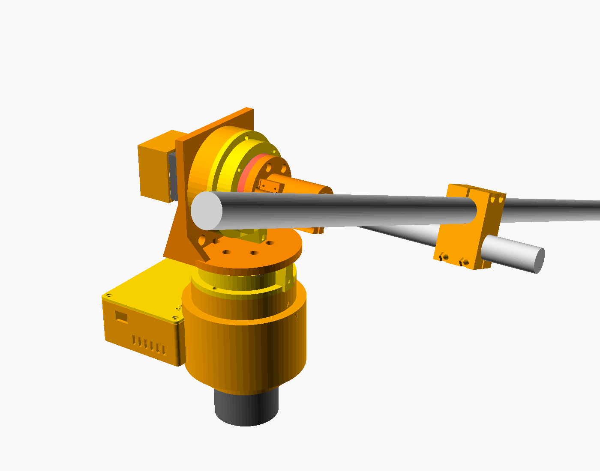
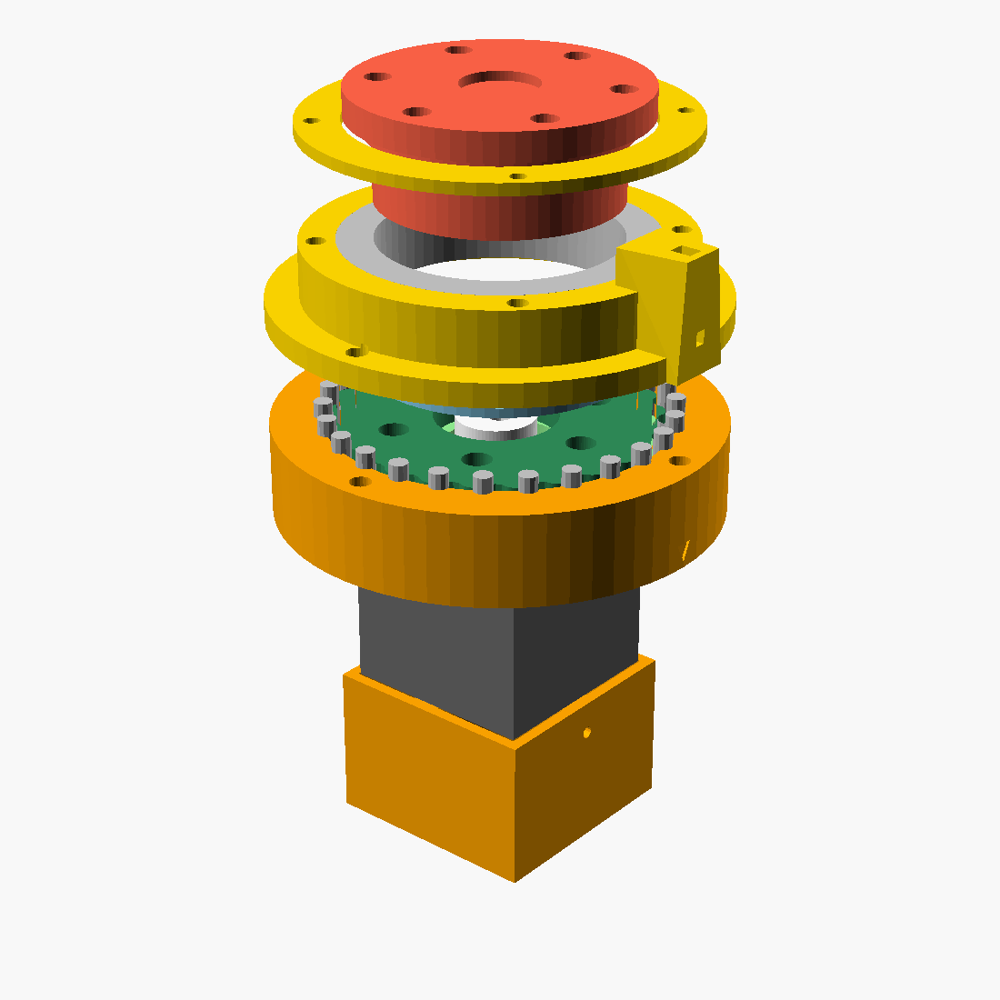

# Mechanical build

Every printed part comes from `cad/lsr.scad`. The parameters live in `cad/lsr_params.scad`; regenerate with `make stl`. Quantities and hardware for one rotator are in [BOM.md](BOM.md).

## 1. Printing

| Parts | Material | Settings |
|---|---|---|
| `act_disc` (×4), `act_cam` (×2) | PETG (or PA-CF / PC) | **100 % infill**, 0.12 mm layers, slow outer wall. The cycloid profile is the precision surface. |
| `act_body`, `act_front_*`, `act_output`, `act_cover`, `act_washer` | PETG / ASA | 4 perimeters, 40 % gyroid, 0.2 mm. Print the body floor-down, the front housing flange-down and the output face-down (as exported). |
| `head`, `base`, `stub_socket` | PETG / ASA | **6 perimeters**, 50 % gyroid. The head prints standing (turntable on the bed). |
| tripod adapters, antenna clamps, e-box | PETG / ASA | 4 perimeters, 30–40 %. Use ASA for parts that stay in the sun. |

**Calibrate first.** Print one `act_disc` and drop it on 3 dowels in the `act_body` grooves. It must rotate freely without rattling.
- If it binds, increase `PROFILE_CLR` (0.15 → 0.20) or `BORE_R`.
- If it rattles, reduce `PROFILE_CLR` to 0.10.

Holes are drawn at nominal size plus the `PRESS` and `TOL` allowances. Check one 61810 bearing seat before printing everything.

## 2. Hardware per actuator (×2)

| Qty | Part | Use |
|---|---|---|
| 1 | NEMA17 17HS4401, **dual shaft** | motor (front shaft 5 mm with a D flat) |
| 26 | dowel 4 × 20 mm | ring pins |
| 6 | dowel 4 × 30 mm | output pins |
| 2 | 6803-2RS (17 × 26 × 5) | cam bearings, one per disc |
| 2 | 61810-2RS (50 × 65 × 7) | output bearings |
| 4 | M3 × 8 | motor to body floor (heads sit in counterbores) |
| 4 + 4 | M3 heat-set insert + M3 × 6 | front cover |
| 3 | M3 × 8 (self-tapping into the 2.6 mm holes) | washer to output hub |
| 6 | M4 heat-set insert (8 mm) | output face |
| 4 | M4 × 35 + nut | through-bolts: front housing, body and the part the actuator mounts on |
| 1 | AS5600 board + 6 × 2.5 mm diametric magnet, 2 × M3 grub | rear-shaft encoder in `enc_cap` |

## 3. Assembling an actuator

1. **Inserts.**
   - Four M3 inserts go into the top face of `act_front`.
   - Six M4 inserts go into the face of `act_output`.
2. **Output pins.** Press the six 4 × 30 dowels into the rear face of the output hub, 16 mm deep, so 14 mm protrude. A vice and a 4 mm drill bit as a depth stop make this easy.
3. **Output bearings.**
   - Press both 61810 bearings into `act_front` from the front until they sit on the rear shoulder.
   - Slide the output hub in from the front until its neck shoulder touches the front inner ring.
   - Fit `act_cover` with 4 × M3 × 6.
   - From behind, fit `act_washer` over the dowels and screw it to the hub with 3 × M3 × 8. The output must turn freely with no axial play.
4. **Motor.** Fix the motor under `act_body` with 4 × M3 × 8 from inside the body. The screw heads go into the counterbores.
5. **Cam.**
   - Press one 6803 bearing onto each cam lobe. The lower lobe, with the small shoulder, takes disc 1.
   - Fit the cam onto the D shaft with a drop of retaining compound (Loctite 638/648 or epoxy). Its hub must clear the motor boss by about 0.4 mm.
   - Let it cure.
6. **Ring pins.** Drop the 26 × 4 × 20 dowels into the floor seats; they rest in the wall grooves. Grease the pins lightly with PTFE or lithium grease.
7. **Discs.**
   - Press a disc onto the lower bearing; it meshes with the pins.
   - Fit the second disc **rotated 180°**: its orientation mark points opposite to the first.
   - Turn the motor shaft by hand: both discs should wobble smoothly and the assembly should not bind.
8. **Close.**
   - Lower the front assembly onto the body. The output dowels go into the disc holes and the ring pin tops into the retainer seats.
   - Turn the output slowly by hand until it drops flat.
   - Insert the 4 × M4 × 35 through-bolts. For bench tests, fit nuts under the floor.
9. **Encoder.**
   - Glue the magnet centred on the rear shaft (diametric: the N/S split faces sideways).
   - Slide `enc_cap` over the motor and lock it with 2 grub screws.
   - Screw the AS5600 board on with the chip facing the magnet, 1–2 mm away; adjust with washers in the slots.
   - In the firmware status `XS` the field `enc=1` must show for that axis.

**Run-in.** Drive each actuator back and forth for 10 minutes at 10°/s without load (`ML`/`MR`). Then re-grease.

## 4. Azimuth base

1. Base inserts:
   - 4 × M4 in the bottom bosses, for the tripod adapter;
   - 4 × M4 in the side pad, for the e-box bracket.
2. Use the AZ actuator with **`act_front_AZ_with_hall_tab`**:
   - Put the DRV5032FB/AH1806 hall sensor in the tab pocket, flat face up.
   - Its wires leave through the side slot.
3. Lower the actuator into the base, motor down:
   - Put 4 × M4 nuts in the traps under the rim.
   - Bolt the actuator through with the 4 × M4 × 35 through-bolts.
   - The **N** arrow on the rim is the azimuth 0 reference. The exact north comes from the sun alignment, so you never need to align it by eye.
4. Bolt the tripod adapter under the base with 4 × M4 × 12. The adapters are:
   - `adapter_3-8in_photo`: captive 3/8″-16 nut. For 1/4″-20 photo tripods add a brass 3/8→1/4 reducer bushing.
   - `adapter_5-8in_survey`: captive 5/8″-11 nut, for aluminium survey tripods (cheap and very stiff, **recommended**).
   - `adapter_spigot_35mm`: speaker or lighting stand pole, M6 thumb screw.
   - `adapter_mast_25/32/40mm`: split socket for a tube mast, 2 × M5.

## 5. Head and elevation

1. Glue a 6 × 3 mm magnet into the pocket under the `head` turntable. Its polarity must trigger your hall sensor; test it with the board.
2. Bolt the head to the azimuth output with 6 × M4 × 10. The bolts go through the counterbores into the output inserts.
3. Mount the EL actuator (`act_front_EL`) on the tower:
   - Its motor and encoder cap pass through the tower window.
   - The 4 × M4 × 35 through-bolts take nuts in the traps on the back of the tower.
4. Bolt `stub_socket` to the EL output with 6 × M4 × 10.
5. Insert the Ø20 stub tube (250 mm) 42 mm deep and tighten the 2 pinch bolts (M4 × 20 + nuts).
6. Fit the boom IMU (GY-521) on the socket pad with 2 × M2.5 screws or ties. The board X axis runs **along the stub**.

## 6. Antenna

1. Find the antenna's centre of gravity, coax included: balance it on a finger.
2. Fit `boom_clamp_Dxx` on the stub (pick the size for your boom: 15/20/22/25 mm or 20 mm square):
   - Clamp the antenna boom at its CG with 4 × M4 × 35 + nuts.
   - Leave about 200 mm between the actuator face and the clamp, so the boom clears the tower and base when it goes vertical.
3. If the antenna is not balanced (heavy feed side), add `counterweight_Dxx` with M8 washers on the light end. Balanced to within about 20 mm, the motor torque goes into wind margin instead of gravity.
4. Clip `sun_sight_Dxx` on top of the boom, parallel to it, with two cable ties. The pinhole vane goes towards the front of the antenna.
5. Coax: run it along the stub to the tower, then down in the azimuth cable loop together with the EL motor and sensor cables.

### Elevation clearance for flip passes

- With the boom vertical, its rear end hangs about 200 mm to the side of the azimuth axis.
- For booms longer than about 1.1 m, add a 300–500 mm extension tube between the tripod and the rotator (`adapter_mast` at the top).
- Alternatively, limit elevation to 90° in the firmware (`XC max_el=90`) and in `config.yaml` (`limits.el_max: 90`).

## 7. Cable loop (azimuth 0–450°)

The EL cables come from the head to the e-box:
- motor: 4-core;
- EL encoder and boom IMU: CAT5e, I²C on two pairs, see [ELECTRONICS](ELECTRONICS.md);
- coax.

To route them:

1. Fasten them to the turntable rim with `cable_clip` and cable ties.
2. Leave a **60 cm loop** in spiral wrap hanging beside the base.
3. Centre the loop at azimuth 225° (half of 450°) before the first HOME.

## 8. E-box

1. Fit the LSR-CTL board on 4 × M3 × 6 into the 16 mm standoffs:
   - The Pi Zero 2 W hangs **under** the board on the header, held by 4 × M2.5 × 11 standoffs.
   - The GPS module sits under the lid window, patch facing up.
2. Screw `ebox_bracket` to the base side pad (4 × M4 × 12).
3. Fix the box on the shelf with 4 × M4 × 10 countersunk screws from inside, so the lid (GPS, bubble level) faces the sky.
4. Openings:
   - the power connectors (XT30, DC jack) face out of the right wall;
   - the Pico USB port is on the left wall;
   - motor cables go through the back glands and sensor cables through the front glands.
