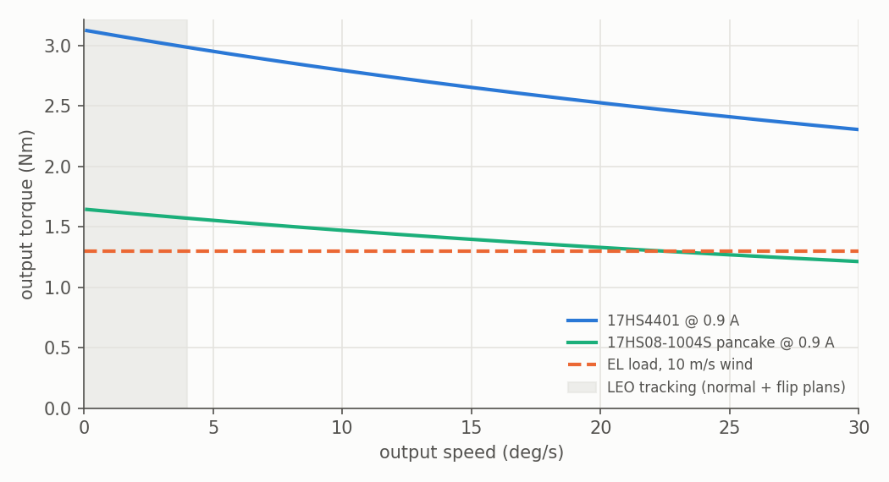
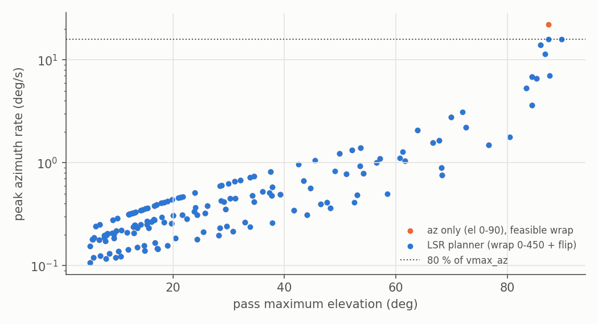
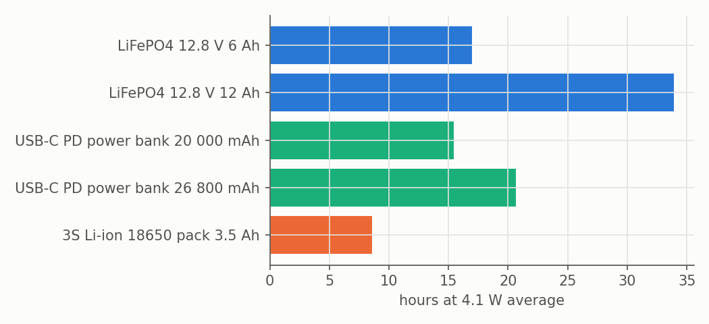

# Engineering budget (generated by calc/sizing.py)

Inputs: antenna 1.0 kg, wind area 0.1 m², centre-of-pressure offset 0.15 m, residual imbalance 20 mm, operating wind 10.0 m/s, gearbox 25:1 at 75%.

## Load torque

| Load | EL (Nm) | AZ (Nm) |
|---|---|---|
| Residual imbalance | 0.20 | 0 |
| Wind 10 m/s (7.4 N) | 1.10 | 1.10 |
| **Total, operating** | **1.30** | **1.10** |
| Wind 20 m/s (holding) | 4.61 | 4.41 |

Cantilever moment on the EL output bearings: 2.0 Nm static (2 × 61810, C0 ≈ 6 kN each: large margin).

## Available torque at the output

| Motor | Current | Holding (powered, standstill) | Running at 2°/s | Running at 20°/s | Safety factor EL @ 2°/s |
|---|---|---|---|---|---|
| 17HS4401 (40 mm, 1.7 A) | 0.9 A | 4.2 Nm | 3.1 Nm | 2.5 Nm | 2.4 |
| 17HS4401 (40 mm, 1.7 A) | 1.2 A | 5.6 Nm | 4.1 Nm | 3.4 Nm | 3.1 |
| 17HS08-1004S pancake (20 mm, 1.0 A) | 0.9 A | 2.2 Nm | 1.6 Nm | 1.3 Nm | 1.2 |
| 17HS08-1004S pancake (20 mm, 1.0 A) | 1.2 A | 2.4 Nm | 1.8 Nm | 1.5 Nm | 1.4 |

The 40 mm motor at 0.9 A gives a safety factor above 2 for a SpaceQuad-class antenna in 10 m/s wind. The pancake "Lite" motor is only for antennas under ~0.6 kg in light wind.

## Pass dynamics (one week, 4 satellites, Madrid)

156 passes above 5°. Without flip and with a plain 0-360 rotator, 25 of them either exceed 16°/s in azimuth or hit the cable-wrap limit mid-pass. The planner used 25 flip/over-the-top trajectories; all passes stay below 16°/s with a worst pointing error of 0.67°.

## Energy budget

| State | Power at 12 V |
|---|---|
| Tracking (both motors at run current 0.9 A) | 7.1 W |
| Idle between passes (hold 35%) | 2.8 W |
| Pi Zero 2 W + Pico + GPS (through the buck) | 1.7 W |
| **Average, 30% of the time tracking** | **4.1 W** |

| Battery | Usable energy | Hours of operation |
|---|---|---|
| LiFePO4 12.8 V 6 Ah | 69 Wh | 16.9 h |
| LiFePO4 12.8 V 12 Ah | 138 Wh | 33.9 h |
| USB-C PD power bank 20 000 mAh (12 V PD trigger) | 63 Wh | 15.4 h |
| USB-C PD power bank 26 800 mAh | 84 Wh | 20.6 h |
| 3S Li-ion 18650 pack 3.5 Ah (11.1 V) | 35 Wh | 8.6 h |

