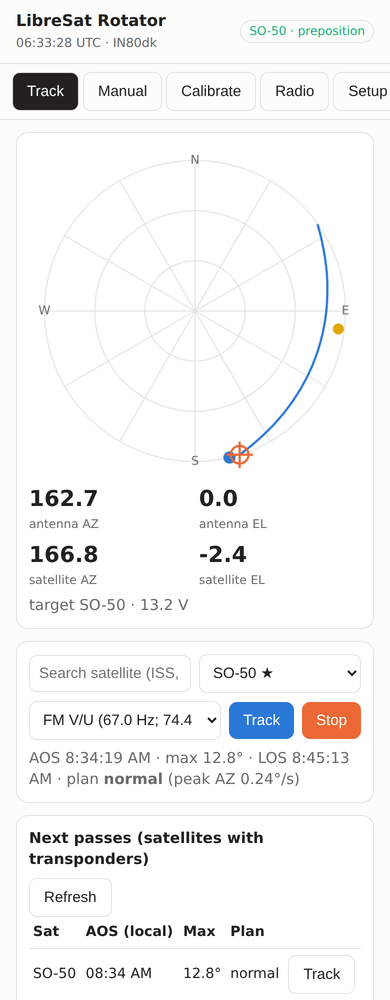

# Head software (Raspberry Pi)

The `lsr` Python package (`software/`) runs on the Pi Zero 2 W fitted under the controller board. It also runs on any Linux PC or Pi connected to the Pico over USB.

| Module | Role |
|---|---|
| `astro.py` | SGP4 look angles (checked against Skyfield: < 0.01° and < 2 m/s), Sun position (checked against astropy: < 0.03°), Maidenhead locator |
| `tle.py` | CelesTrak GP download with an **offline cache** |
| `passes.py` | Pass prediction and the **planner**: normal, flip and cable wrap |
| `tracker.py` | The engine: plan → steer (`XP`) → Doppler; GPS position; sun alignment |
| `rotctld.py` | Hamlib-compatible server on :4533 (Gpredict, Look4Sat, SatNOGS, `rotctl -m 2`) |
| `doppler.py`, `satdb.py` | Doppler engine (FM and linear with knob follow) and the transponder list (`lsr/data/satellites.yaml`, plus a SatNOGS DB import) |
| `rigs/ftx1.py` | Yaesu FTX-1 direct CAT |
| `rigs/hamlib_net.py` | Any radio through `rigctld` |
| `rigs/opengd77.py` | OpenGD77 clock sync, radio info, keps upload, NMEA |
| `web/` | Mobile web UI and JSON API on :8080 |
| `timesync.py` | Sets the clock from GPS when there is no NTP |

## Install on the Pi Zero 2 W

1. Flash **Raspberry Pi OS Lite (Bookworm)** with Raspberry Pi Imager. Set the hostname `lsr`, your Wi-Fi network and SSH.
2. Then run:

   ```bash
   git clone <this repo> && cd libresat-rotator/software
   sudo scripts/install_pi.sh          # venv in /opt/lsr, service 'lsr', UART enabled, config in /etc/lsr/config.yaml
   sudo nano /etc/lsr/config.yaml      # your location, radio (see scripts/config.example.yaml)
   sudo scripts/setup_hotspot.sh LibreSat-Rotator mypassword    # field access point (optional)
   sudo systemctl restart lsr
   ```

3. Open **http://lsr.local:8080**. On the field hotspot the address is **http://10.42.0.1:8080**.

To try it without hardware: `pip install ./software && lsr run --sim`.

## Web UI



| Tab | What it does |
|---|---|
| **Track** | Sky plot with the pass track, the satellite, the Sun and the antenna cross-hair (over-the-top positions are mapped back onto the sky). Search a satellite, pick a transponder, then **Track** or **Stop**. The next-passes table covers every satellite in the transponder list, with the planner decision (normal or flip). |
| **Manual** | Go to an az/el, jog pad, park, HOME |
| **Calibrate** | Base tilt, sun alignment (azimuth, or azimuth and elevation), elevation zero, IMU, index azimuth |
| **Radio** | Live RX/TX Doppler frequencies; OpenGD77 info, clock sync and keps upload |
| **Setup** | Station position, TLE update or paste, raw controller status |

The API (`/api/status`, `/api/track`, `/api/passes?sat=`, `/api/upcoming`, `/api/goto`, `/api/cal/sun` …) is plain JSON over HTTP. See `lsr/web/server.py`.

## Command line

```
lsr passes ISS --hours 24     # passes with the plan: normal/flip, cable-wrap offset, peak azimuth rate
lsr track SO-50               # terminal tracking with Doppler
lsr tle update                # refresh the TLE cache (needs internet once)
lsr satdb update              # import alive amateur transmitters from SatNOGS DB
lsr sun                       # Sun azimuth/elevation now (alignment)
lsr status                    # controller status and decoded errors
lsr gd77 info|clock|keps|nmea
lsr calibrate level|compass|sun|sun-manual|index|all [--sim]   # automatic calibration, see CALIBRATION.md
lsr pointing fit points.csv [--terms ...] [--save] [--enable]   # least-squares pointing model, prints the residual RMS
```

Phase 8 modules: `geomag.py` (WMM declination), `calibration.py` (level, compass, Sun, index/backlash), `pointing.py` (correction model and fit), `control.py` + `CorrectedRotator` in `rotator.py` (deadband, step-loss and stall supervision, soft limits, feed-forward, safe states), `lsq.py` (plain-Python least squares, no numpy). With `pointing.enabled` and `control.enabled` both false the rotator behaves exactly as before. Extra API: `GET /api/calibration`, `POST /api/calibrate/{level|compass|sun|sun-manual|index}`, `POST /api/control/clear`. Procedure: [CALIBRATION](CALIBRATION.md).

## Using Gpredict, Look4Sat or the SatNOGS client

The internal tracker steps aside as soon as a `rotctld` client sends a position.

- **Gpredict** (PC on the same network): Edit → Preferences → Interfaces → Rotators → Add:
  - host `lsr.local` (or `10.42.0.1`), port `4533`;
  - AZ type 0°→180°→360°, min/max elevation 0/180.
  In Antenna Control, choose it and press **Engage**.
- **Look4Sat** (Android): Settings → rotator control → address `10.42.0.1`, port `4533`.
- **SatNOGS client**: `SATNOGS_ROT_MODEL=ROT_MODEL_NETROTCTL`, `SATNOGS_ROT_PORT=<pi>:4533`.
- **Directly over USB to the Pico, without the Pi**: `rotctld -m 202 -r /dev/ttyACM0 -s 115200` (Easycomm II).

## Yaesu FTX-1 (CAT Doppler)

**Wiring.** One USB-C cable from the FTX-1 to the Pi (a hub if a Pi 4/5 also feeds other devices). The radio shows two CP210x ports; use the **Enhanced** one (`…-if00-port0`). On the radio set CAT-1 RATE to **38400**.

**Configuration** (`/etc/lsr/config.yaml`):

```yaml
rig:
  type: ftx1
  ftx1: {port: /dev/serial/by-id/usb-Silicon_Labs_..._if00-port0, baud: 38400, sub_tx: true, cat_tone: false}
```

**How it drives the radio:**
- MAIN = downlink (RX), written with `FA%09d;`.
- SUB = uplink (TX), written with `FB%09d;`.
- Modes: `MD0x;` on MAIN and `MD1x;` on SUB (USB/LSB/FM/CW from the transponder entry).
- **No hardware split is used.** The FTX-1 split state showed synchronisation problems through Hamlib (issue #1972). On the radio, select SUB as the transmit band and enable cross-band full duplex (satellite operation) before the pass.

**FM satellites** (SO-50, ISS, AO-91, PO-101) get both frequencies corrected, in 100 Hz steps.
- Set the CTCSS tone on the radio's SUB band by hand (e.g. 67.0 Hz).
- `cat_tone: true` sends the FT-991-style `CN`/`CT` commands. **VERIFY** this on your firmware first.

**Linear satellites** (RS-44, FO-29, AO-7, AO-73) follow the knob:
- Tune the **downlink** with the MAIN knob. The software reads `FA;` back, works out the satellite-frame frequency and moves the uplink. It moves the opposite way on inverting transponders.
- Both frequencies are corrected for Doppler every 0.5 s, in 10 Hz steps.

**VERIFY on your radio:**
- Send `FB145900000;` manually (for example `lsr track` with `rig.type: ftx1`) and check that SUB moves.
- If your FTX-1 firmware addresses the sub band differently, use the Hamlib backend below.

### FTX-1 through Hamlib (alternative)

Hamlib 4.7 / master has model 1051 (FTX-1). Run it in VFO mode:

```bash
rigctld -m 1051 -r /dev/serial/by-id/...-if00-port0 -s 38400 --vfo -t 4532 &
```

```yaml
rig: {type: hamlib, hamlib: {host: 127.0.0.1, port: 4532, vfo_mode: true, rx_vfo: Main, tx_vfo: Sub}}
```

The same works for any Hamlib radio, e.g. IC-9700 (`-m 3081`, `rx_vfo: Main`, `tx_vfo: Sub`) or FT-991A with split (`vfo_mode: false`).

## OpenGD77

OpenGD77 has no CAT frequency control, but its **satellite mode computes Doppler itself** from keps stored in the radio, and it needs a correct UTC clock. LSR-1 keeps the radio ready and points the antenna:

| Action | How | Protocol (from the OpenGD77 CPS / WebCPS) |
|---|---|---|
| Sync the clock to UTC (from GPS or NTP) | web UI Radio → *Sync clock*, or `lsr gd77 clock` | `C 0` (CPS mode) → `C 6 7 <unix time LE>` → `C 5`, `C 7` |
| Radio info | `lsr gd77 info` | `R` mode 9 (46 bytes: model, firmware build) |
| **Upload keps (experimental)** | web UI → *Upload keps* or `lsr gd77 keps SO-50 ISS AO-91` | Read the custom-data area (`R` mode 1), replace block type 3 (25 × 100-byte records: name, packed TLE, RX/TX, CTCSS), write it back (`W`/`X` prepare/send/write sector), then clock sync and reboot. A **backup** goes to `~/.local/share/lsr/gd77/` first. |
| Position from a GPS radio | `lsr gd77 nmea` | NMEA streamed on the USB port outside CPS mode |

The record packing is checked **byte for byte** against WebCPS's `buildSatelliteRecords()` (`tests/test_opengd77.py`, golden file made by running the WebCPS JavaScript).

**Field workflow:**
1. Before leaving: *Upload keps* once with fresh TLEs, then *Sync clock*.
2. In the field: on the radio pick **Satellite** → SO-50 (for example).
3. On the phone: **Track** SO-50. The rotator follows the satellite and the radio corrects Doppler on its own.

## Offline operation

- TLEs are cached in `~/.local/share/lsr/tle/`. Run `lsr tle update` at home; they stay usable for about 1–2 weeks for LEO pointing.
- With no NTP, the clock is set from the controller GPS (`CAP_SYS_TIME` in the service).
- The station position comes from the GPS too (`station.use_gps: true`). The web UI shows the locator and "(GPS)".

## Tests

```bash
cd software && python3 -m pytest -q      # 25 tests: astro vs Skyfield, planner, Doppler, rotctld,
                                         # FTX-1 strings/IO, Hamlib, OpenGD77 golden, full pass simulation
```
